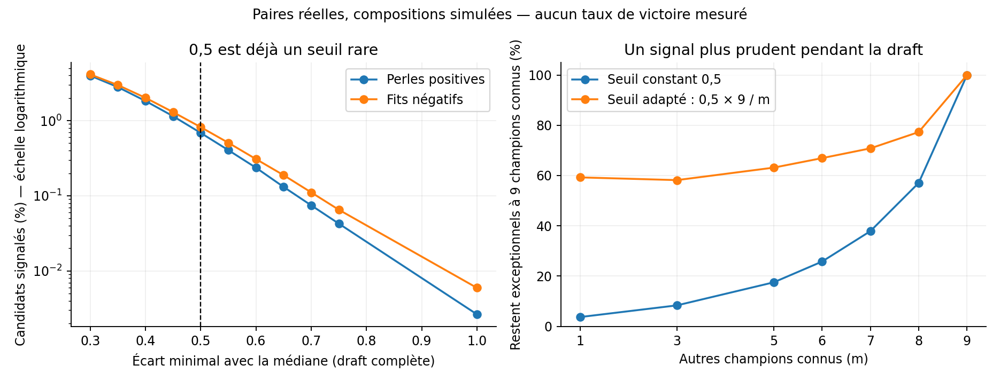

# « Perles rares » : proposition calibrée hors site

Étude du 17 novembre 2026. **Aucune modification de l’interface, de Netlify, des comptes, des salles ou du calcul des scores.** Les seules requêtes distantes sont des lectures des statistiques déjà publiées ; aucune collecte Lolalytics supplémentaire.

## Proposition retenue

Conserver l’idée « top 5 % et écart de 0,5 », mais **rendre le seuil plus exigeant quand la draft est incomplète**.

Pour un candidat, on calcule son score individuel ajusté habituel `S` et la médiane `M` des champions disponibles à ce rôle, dans le même contexte. Si `m` autres champions sont renseignés, entre 1 et 9 :

```text
Perle positive : S > 0, S ≥ percentile 95, S − M ≥ 0,5 × 9 / m
Fit négatif    : S < 0, S ≤ percentile  5, S − M ≤ −0,5 × 9 / m
```

| Autres champions connus | Écart requis avec la médiane |
| --- | ---: |
| 1 | 4,50 |
| 3 | 1,50 |
| 5 | 0,90 |
| 6 | 0,75 |
| 8 | 0,5625 |
| 9 | 0,50 |

Le score affiché reste la moyenne habituelle des contributions connues. C’est seulement l’exigence pour obtenir le marquage qui augmente. Le facteur `m/9` mesure la contribution déjà établie à un avantage global de 0,5 ; **il ne prédit pas les futurs picks à zéro et ne fournit pas un intervalle de confiance**.

La référence comprend tous les champions passant le filtre actuel de rôle, soit au moins 5 % de leurs parties à ce poste, et disponibles dans cette draft. Elle ne se limite pas aux cinq candidats visibles ou au pool personnel. Les autres picks et bans sont exclus ; le pick actuellement sélectionné dans le rôle évalué reste une alternative comparable. Un candidat personnel hors filtre peut être comparé au même référentiel : une vérification complémentaire n’a trouvé aucun signal positif ou négatif hors filtre sur ce corpus après shrinkage et contrôle de couverture.

Le marquage exige des données connues pour **toutes les interactions actuellement présentes**, et au moins vingt scores de référence exploitables. Zéro champion connu, données manquantes ou référence insuffisante : pas de marquage exceptionnel. Un score inconnu n’est jamais remplacé par zéro. Avant neuf autres champions, tout signal reste explicitement **provisoire**. Les calculs utilisent les valeurs non arrondies.

Il peut n’y avoir aucune perle. Le premier d’une petite liste n’est pas automatiquement exceptionnel. Les mots proposés seraient **Excellent fit** / **Poor fit**, plutôt que « counter » qui pourrait être compris comme un seul duel.

## Données et méthode

- Snapshot actuellement publié, acquis le **14 novembre 2026** : `603d12557a32514a5d4ddf8e3c7655b9011d661fac5d67e021eab77b2118f9a3`.
- Lolalytics, Global, Solo/Duo, Emerald+, fenêtre glissante de 14 jours ; **782 306 paires**, 865 fragments. Ce ne sont pas 782 306 parties indépendantes.
- Modèle utilisé par le site : **k = 2 510,0480193943954**. Chaque contribution vaut `delta2 × n / (n + k)`, puis moyenne égale des contributions connues. Le modèle et les observations restent inchangés.
- Catalogue de 413 couples champion/rôle ; 334 passent le filtre de rôle : Top 86, Jungle 71, Mid 74, Bottom 44, Support 59.
- Export compact lu une fois en 44 petits lots, trois lectures simultanées maximum. Empreinte : `1820e1e7719b0d289a97b0948398777061fd849d26d9351668b9b06e7d0d8c88`. Le corpus complet reste dans le dossier local ignoré `work/exceptional-picks`.

**11 500 compositions simulées**, avec dix champions distincts et dix bans disponibles tirés selon leur popularité :

| Ensemble | Drafts | Usage |
| --- | ---: | --- |
| Populaire, seed 17011 | 2 000 | Comparaison initiale des règles |
| Populaire, seed 17012 | 4 000 | Fréquences, candidats visibles, drafts partielles |
| Uniforme, seed 17013 | 1 500 | Stress avec davantage de choix inhabituels |
| Deux choix optimisés au score, seed 17016 | 1 500 | Sensibilité à des compositions moins aléatoires |
| Populaire, seed 17021 | 2 500 | Nouvelle simulation après fixation de la proposition finale |

Les tirages populaires utilisent les nombres de parties par rôle comme poids, normalisés. Ce ne sont pas des drafts humaines observées. Le test optimisé remplace un jungler allié puis un mid ennemi par leur meilleur candidat au score dans la composition courante ; ce n’est ni un solveur stratégique ni un équilibre de jeu.

Chaque draft permet d’évaluer les cinq rôles alliés, en remplaçant virtuellement leur champion. Les neuf autres picks forment le contexte, conservant les vrais effets et corrélations entre candidats affrontant les mêmes champions. Pour les drafts partielles, l’ordre de révélation est aléatoire : les picks cachés ne servent ni au score, ni aux exclusions, ni aux percentiles. Les dix bans sont supposés déjà connus, comme après la phase de bans ranked. La persistance des signaux est calculée parmi les candidats restés disponibles à la fin ; les cas devenus indisponibles sont comptés séparément dans le JSON.

Le contrôle indépendant par boucle scalaire de la formule du site porte sur 600 cas, avec 1, 3, 6 ou 9 interactions : erreur maximale **2,22 × 10⁻¹⁶**. Des cas artificiels vérifient également qu’une liste plate n’impose aucun gagnant, qu’une liste entièrement négative ne produit pas de perle positive et qu’un zéro ne devient pas une perle par simple comparaison à des scores négatifs.

## Pourquoi 0,5 plutôt que 0,3 ou 0,75 ?

Drafts complètes, contrôle sur les 4 000 nouvelles compositions, percentile 95 et signe positif requis :

| Écart minimal avec la médiane | Candidats signalés positivement |
| --- | ---: |
| 0,30 | 3,97 % |
| 0,40 | 1,83 % |
| **0,50** | **0,69 %** |
| 0,60 | 0,24 % |
| 0,75 | 0,043 % |
| 1,00 | 0,0026 % |

Dans ce corpus, 0,5 est déjà un avantage global inhabituel. Le relever à 0,75 supprimerait presque tous les signaux. Des seuils bas ou un simple « top 5 % » coloreraient fréquemment des différences modestes.

Passer au percentile 97,5 ou ajouter un écart-type robuste apporte peu ici : le plancher de 0,5 est généralement la contrainte déterminante. Cela ajoute des paramètres sans bénéfice suffisant pour cette première version. Une borne absolue sans comparaison aux autres choix risquerait inversement de qualifier beaucoup de candidats dans un contexte qui favorise tout le rôle.

Sur la **dernière simulation de 2 500 drafts**, soit 12 500 cas de rôle et 754 903 candidats exploitables : **5 367 signaux positifs (0,711 %)** et **6 274 négatifs (0,831 %)**. Au moins une perle positive existe dans 32,6 % des cas de rôle si l’on regarde tous les champions disponibles. Dans le test reproduisant les **cinq candidats populaires affichés**, elle apparaît dans **8,42 % des cases**, soit environ une case sur douze. Dans un pool de cinq candidats tirés selon la popularité : 6,53 %. Ce ne sont pas des probabilités de gagner.

## Pourquoi adapter le seuil pendant la draft ?

Un duel très favorable peut suffire à produire une forte moyenne quand il n’y a qu’un ou trois autres champions connus. Ajouter des interactions rapproche souvent cette moyenne de zéro, même si le candidat reste bon.

Sur les 4 000 compositions de contrôle :

| Autres champions connus | Seuil constant 0,5 : restent exceptionnels à la fin | Seuil adapté : restent exceptionnels à la fin |
| --- | ---: | ---: |
| 3 | 8,3 % | 58,2 % |
| 6 | 25,8 % | 66,9 % |
| 8 | 57,1 % | 77,3 % |

La simulation finale confirme environ **67,8 % à six champions** et **77,9 % à huit** avec la règle adaptée. À six champions, 99,9 % des candidats ainsi signalés restent au-dessus de la médiane finale dans cette nouvelle simulation ; certains ne sont simplement plus assez exceptionnels pour garder le marquage. Ces pourcentages décrivent la stabilité des scores dans le générateur testé, pas une fiabilité prédictive réelle. Les très rares signaux à un seul champion connu reposent sur trop peu de cas pour en déduire une garantie.



[Figure vectorielle exportable](exceptional-pick-calibration.svg).

## Exemple : Sylas Top contre Malphite

Composition illustrative construite avec des champions joués dans ces rôles :

| Rôle | Alliés | Ennemis |
| --- | --- | --- |
| Top | **Sylas** | **Malphite** |
| Jungle | Lee Sin | Amumu |
| Mid | Orianna | Viktor |
| Bottom | Jinx | Jhin |
| Support | Thresh | Alistar |

Le delta ajusté Sylas Top contre Malphite Top vaut **+4,993**. Le score de Sylas contre/avec les **neuf** autres champions vaut **+0,854** ; la médiane des alternatives Top vaut **+0,039**, et le percentile 95 **+0,332**. Son avance globale sur la médiane est donc **+0,814** : il passe les deux critères et serait signalé. Ce n’est pas le seul +4,993 qui déclenche directement le marquage.

## Limites et suivi

La calibration choisit une fréquence d’affichage rare et teste la sensibilité de ce repère. Il n’existe pas ici de vérité terrain définissant une « perle », ni de résultats de parties pour démontrer un meilleur taux de victoire. Les simulations réutilisent le même corpus ; des graines différentes ne constituent pas une validation sur de nouvelles données réelles.

Les fréquences restent faibles avec les compositions uniformes et avec les deux choix optimisés. Les candidats hors filtre sont généralement très rapprochés de zéro par le shrinkage : aucun signal observé dans le test complémentaire, ce qui ne prouve pas qu’ils sont mauvais. Les données peuvent simplement ne pas permettre de conclure.

Un contrôle sur le snapshot archivé du 12 novembre vérifie les empreintes de ses 865 fragments. En gardant k identique, environ **67,7 %** des perles du snapshot du 14 restent au-dessus du seuil exceptionnel dans celui du 12, et toutes restent au-dessus de sa médiane dans ce test. Les fenêtres de 14 jours se chevauchent fortement : **ce n’est pas une validation temporelle indépendante**. Une étiquette à seuil peut changer lors d’un refresh, surtout près de la frontière.

Doubler k fait tomber beaucoup de scores sous 0,5 : seulement 15,2 % des anciens signaux gardent l’étiquette, mais tous restent au-dessus de la médiane. C’est une sensibilité réelle à la force de shrinkage. Il faut réexaminer la calibration après un changement important de k, de palier ou de source, et surveiller les gros changements de patch. **Ne pas réajuster automatiquement le seuil à chaque refresh pour forcer un quota de perles.**

La variance exacte des Delta 2 et leurs dépendances ne sont pas connues. Les perturbations de k, les retraits d’une interaction et les variations de composition sont des contrôles de sensibilité, pas des intervalles de confiance ou des tests de significativité.

## Reproduction

Tous les scripts sont isolés dans `scripts/experiments`, avec NumPy 2.3.5 ; Matplotlib 3.10.8 sert uniquement à produire le graphique. Aucun paquet n’a été ajouté au frontend. Depuis la racine du dépôt :

```sh
# Facultatif si le cache local existe : lecture du snapshot, aucune écriture distante.
# Nécessite les accès Supabase administratifs déjà configurés, jamais des secrets VITE_*.
python3 scripts/experiments/exceptional_pick_fetch.py

OPENBLAS_NUM_THREADS=1 python3 scripts/experiments/exceptional_pick_calibration.py
OPENBLAS_NUM_THREADS=1 python3 scripts/experiments/exceptional_pick_refine.py
OPENBLAS_NUM_THREADS=1 python3 scripts/experiments/exceptional_pick_stress.py
OPENBLAS_NUM_THREADS=1 python3 scripts/experiments/exceptional_pick_examples.py
OPENBLAS_NUM_THREADS=1 python3 scripts/experiments/exceptional_pick_validate_final.py
OPENBLAS_NUM_THREADS=1 python3 scripts/experiments/exceptional_pick_visible_pools.py
OPENBLAS_NUM_THREADS=1 python3 scripts/experiments/exceptional_pick_offrole.py
MPLCONFIGDIR=/tmp/draftroom-calibration-mpl python3 scripts/experiments/exceptional_pick_report.py
```

Le contrôle archivé exige également le cache local du 12 novembre. La rétention du service peut supprimer un ancien snapshot : les entrées locales sont nécessaires pour reproduire exactement les nombres de cette étude, plutôt que tirer silencieusement de nouvelles données.

[Résultats structurés, règles, graines et exemples](exceptional-pick-calibration-results.json).
