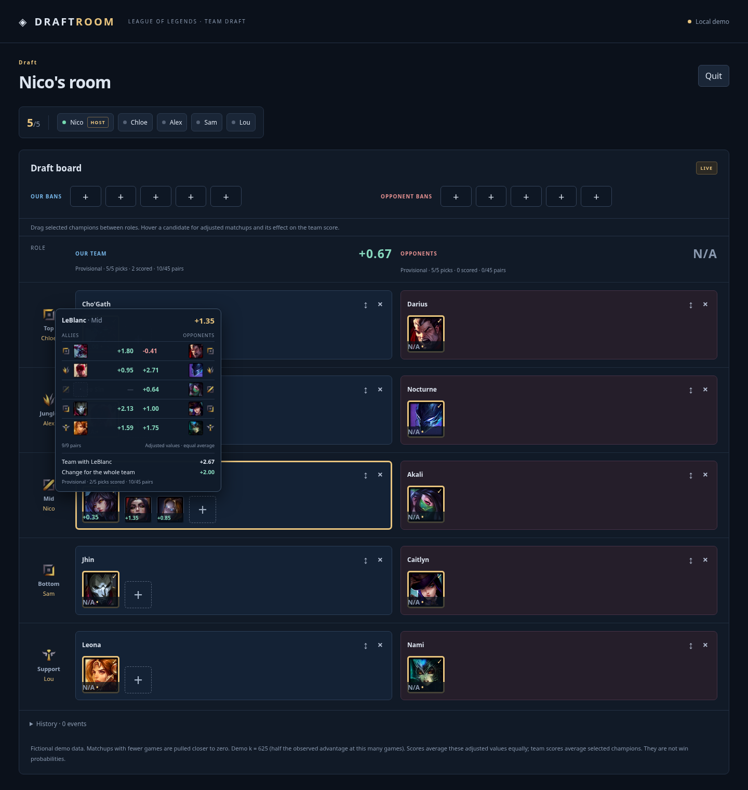

# Scores ajustés, équipes et rafraîchissement matinal

Demande du 14 novembre 2026, branche `feat/team-scores-shrinkage`.
Les comptes et présélections persistantes restent hors de ce lot.
Ces décisions remplacent celles des anciens rapports concernant le score brut.

## Calcul présenté aux joueurs

Chaque contribution devient `delta2 × n / (n + k)`, avec le nombre de parties
de cette paire précise et **un seul k partagé** par Against et Synergy, tous
rôles inclus. On moyenne ensuite les contributions connues à poids égaux.
Le dénominateur est leur nombre, jamais la somme des facteurs de shrinkage.
Les valeurs positives et négatives sont rapprochées de zéro.

Ni seuil de 100 parties, ni suppression d'observations rares. Les vrais zéros
avec un nombre positif de parties restent connus. Un Delta 2 manquant, un
nombre de parties absent ou nul, ou une calibration absente produisent N/A ;
aucun résultat brut n'est présenté comme ajusté. Le corpus brut n'est pas réécrit.
Les imports manuels sans calibration ne produisent donc pas de score brut de
repli. La démo utilise un k explicitement fictif de 625.

Le score d'équipe est la moyenne des scores des champions effectivement
sélectionnés et calculables. Il affiche les picks, le nombre de champions
calculables et la couverture. Une draft incomplète ou une couverture partielle
reste marquée Provisional. En contexte complet, chaque équipe a 45 contributions
directionnelles possibles. Les deux scores ne sont pas supposés opposés et ne
représentent pas une probabilité de victoire.

Le panneau au survol d'un candidat montre ses contributions ajustées, le score
d'équipe après remplacement et sa variation. Tous les coéquipiers sont recalculés
avec le candidat. Le survol ne modifie aucune sélection, aucun pool, aucune salle
et ne contacte pas Lolalytics. Le pick sélectionné garde sa priorité visuelle ;
les candidats restent triés par score individuel.

L'explication en bas indique la source, la fenêtre et le palier réels du dataset,
la réduction des petits échantillons, k et sa date. Les contributions affichées
sont uniquement les valeurs ajustées.

## Apprentissage et conservation de k

Le backend ajuste un modèle Normal–Normal centré sur zéro, avec variance de
bruit de travail `2500/n` en points de pourcentage au carré. Une recherche
numérique de la variance des effets optimise la vraisemblance marginale de
travail. Les observations sont regroupées par n en conservant effectifs et
sommes des carrés : cela préserve exactement l'objectif de calibration.

`k = 2500 / variance_des_effets`. La frontière variance=0 est représentée
explicitement par `k:null` (k infini, ajustement à zéro), sans borne arbitraire.

Le paramètre est appris sur **le corpus complet**, jamais sur le pool local ou
les seuls fragments chargés. Il est réutilisé durant 30 jours dans le même
contexte (source, palier, filtres et méthode), puis réappris au prochain refresh
réussi. Un changement de contexte exige une nouvelle calibration. Elle reste
figée pour son snapshot et ne change donc pas pendant une draft.

La migration additive **010** ajoute `statistics_calibrations`, indexée par
snapshot, lisible pour les snapshots prêts par les clients authentifiés et
non modifiable par eux. Les modèles sont immuables. Leur suppression suit celle
du snapshot en cascade ; aucune rétention infinie de modèles n'est ajoutée.
La référence du snapshot d'apprentissage est documentaire et ne bloque pas sa
rétention. Le publisher installe le modèle dans la transaction de promotion ;
un échec de calibration empêche la promotion. Le cache charge une calibration
par snapshot et ne la renvoie jamais dans les mutations de salle.

Le contrôle initial en lecture seule du snapshot `603d1255…` a donné
**k ≈ 2 510,048**, variance des effets ≈ 0,995997, sur **782 306 observations** :
430 717 Against et 351 589 Synergy. Ce sont des observations de paires, pas
d'autant de parties indépendantes. `calibrate_snapshot.py` prépare ce modèle
sans collecte ; seule l'option `--apply` insère son enregistrement.

**Limites :** `2500/n` est une approximation, pas la variance exacte du Delta 2.
Les paires partagent des parties ; la vraisemblance est une approximation de
travail. Aucune amélioration prédictive sur des fenêtres indépendantes n'est
revendiquée avant validation temporelle. La rétention opérationnelle actuelle
ne conserve pas un historique complet destiné à cette validation.

Référence : [modèle Normal–Normal et Empirical Bayes](https://cloud.r-project.org/web/packages/ebnm/vignettes/shrink_intro.html).

## Enquête sur les horaires

L'ancienne définition était `17 6 * * *` sans fuseau, donc 06:17 UTC,
07:17 en Suisse en novembre et 08:17 en été.

| Exécution | Événement API | Création/début, heure suisse | Fin, heure suisse |
| --- | --- | --- | --- |
| [13 novembre](https://github.com/NicoHelemon/lol_drafter/actions/runs/43445043966) | schedule, tentative 1 | 15:40:57 | 16:16:21 |
| [14 novembre](https://github.com/NicoHelemon/lol_drafter/actions/runs/43600739558) | schedule, tentative 1 | 14:37:59 | 15:13:20 |

Ces passages sont distincts des tests `workflow_dispatch` du 12 novembre.
Le décalage de plusieurs heures ne s'explique pas par le fuseau. Sur le passage
du 13, le premier job démarre quelques secondes après la création du run :
l'attente principale précède cette création, pas l'attribution de ce runner.
L'API n'expose pas la raison interne de ce retard.

La définition vise désormais **06:00 Europe/Zurich**, été/hiver automatique.
Un contrôle initial refuse toute collecte automatique hors de **06:00–08:00**
et laisse une annotation d'avertissement et un résumé explicites. La fenêtre
est revérifiée avant publication, puis dans la transaction PostgreSQL avec
`clock_timestamp()` pour couvrir l'attente de verrou. Le dernier snapshot valide
est conservé si le job arrive trop tard. Une opération manuelle explicite reste
possible ; `publish=false` reste le défaut, sans collecte ni publication.

La durée réelle est d'environ 35 minutes : 06:00 est l'heure cible de départ,
pas celle de disponibilité garantie. GitHub ne garantit pas une ponctualité
stricte. Cette fenêtre empêche l'interférence diurne ; elle ne répare pas
l'ordonnanceur GitHub. Le prochain déclenchement automatique devra être observé.

Référence : [planification GitHub et fuseaux IANA](https://docs.github.com/en/actions/reference/workflows-and-actions/workflow-syntax#onschedule).

## Vérifications

- 77 tests TypeScript/PostgreSQL/PGlite réussis.
- 47 tests Python réussis : signal synthétique connu, frontière variance nulle,
  réutilisation/expiration de k, contexte distinct et fenêtre été/hiver.
- 19 parcours Playwright réussis : aperçu d'équipe avec effet sur un autre allié,
  contributions ajustées, couverture, absence de calibration et mobile.
- Build TypeScript/Vite et actionlint 1.7.12 réussis. L'ancien actionlint 1.7.7
  ne connaît pas `timezone` ; le contrôle a été effectué avec la version récente.
- [CI de branche initiale](https://github.com/NicoHelemon/lol_drafter/actions/runs/43620567391) réussie.
- [Précontrôle Actions](https://github.com/NicoHelemon/lol_drafter/actions/runs/43620636942)
  réussi : jobs schedule et validate exécutés, audit Supabase réellement lu,
  job refresh ignoré comme prévu avec `publish=false`. Aucune collecte/publication.

Le test hébergé `scripts/statistics/verify_production.mjs` compare scores
individuels, moyenne d'équipe, remplacement par Camille et explication de k
aux observations canoniques lues côté backend. Il crée une salle temporaire,
ne transmet pas le jeton de gestion au navigateur et quitte la salle ensuite.

Les captures de démonstration utilisent des observations et un k synthétiques.

