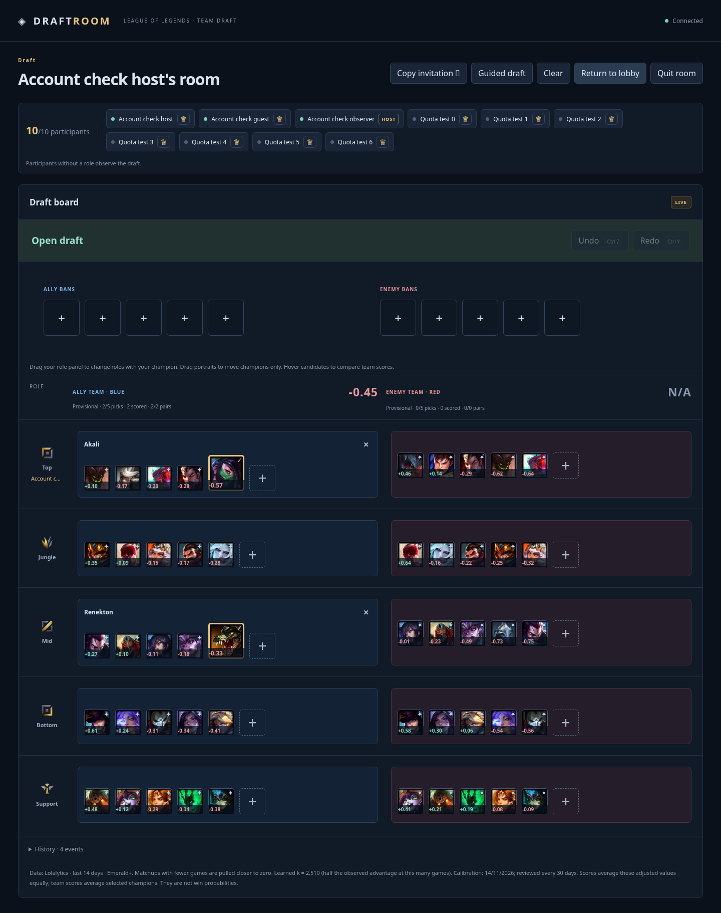

# Comptes personnels et dix participants

Demande du 16 novembre 2026, branche `feat/accounts-ten-members`. Migration 018 après 017. Interface en anglais.

## Compte facultatif

L’accueil permet de demander un code par email, de le saisir, puis de choisir un pseudo et cinq listes de champions, une par rôle. Aucun mot de passe ; l’adresse doit être vérifiée par Supabase Auth. Le mode invité reste disponible. La connexion et l’édition globale du profil se font avant de rejoindre une salle, jamais au milieu de celle-ci. Un changement d’identité dans un autre onglet ferme la vue de salle sur cet appareil pour éviter de continuer avec l’ancienne identité.

Chaque profil est lisible uniquement par son propriétaire via RLS, sans copie de l’email dans la salle. Les écritures passent par `save_my_profile`, qui valide les listes et une version attendue pour éviter d’écraser une modification concurrente. Le profil est relu à l’ouverture de son éditeur. Seuls les comptes avec email confirmé peuvent persister un profil ; une identité anonyme ne le peut pas.

Prendre ou changer de rôle charge la liste personnelle du rôle cible, même vide, et remplace les candidats préparés pour cette case. Le champion déjà sélectionné suit le joueur lors d’un échange de rôles en draft. Un échange entre deux rôles incarnés exige toujours le consentement ; les préférences ne sont chargées qu’à l’acceptation. Pour un invité sans profil, le pool de session reste conservé.

Modifier les candidats d’une salle ne change jamais les préférences personnelles. Le bouton **Save my role pool**, limité à son propre rôle et aux comptes connectés, demande confirmation et enregistre explicitement ce seul rôle, en préservant les quatre autres listes du profil. Un nom différent utilisé dans une salle ne renomme pas implicitement le profil.

## Participants et hôte

Dix personnes maximum, sans choix Player/Observer à l’invitation et sans quotas séparés. Un participant sans rôle observe ; il peut prendre un rôle libre dans le lobby ou la draft, puis utiliser **Observe** pour le libérer. Les cinq rôles restent uniques, donc cinq personnes au maximum les incarnent. Libérer un rôle laisse le champion sélectionné dans sa case. Les arrivées et départs de participants sans rôle ne détruisent pas l’historique Undo/Redo.

Un observateur ordinaire ne peut pas modifier les candidats, picks ou bans ; le serveur impose cette règle. L’hôte peut observer et conserve ses commandes de gestion. Il peut transmettre l’hébergement à tout autre membre après confirmation ; le transfert ne modifie ni la draft ni son historique. Les boutons d’action expliquent leur effet au survol.

## Email et exploitation

L’utilisateur a configuré Brevo SMTP dans Supabase ; les identifiants ne figurent ni dans le code ni dans les preuves. L’URL Auth pointe vers `https://draftroom-lol.netlify.app`. Les modèles inscription et connexion affichent uniquement un code (`{{ .Token }}`), valable dix minutes ; l’expiration serveur est alignée. Le débit d’envoi configuré est dix emails par heure pour le projet. Le frontend accepte les codes numériques de six à dix caractères (configuration actuelle : huit). La clé SMTP créée par l’utilisateur est annoncée expirant le 16 novembre 2027 dans sa capture Brevo ; la renouveler avant cette date pour maintenir l’envoi.

`account_features.email_login_ready` permet d’ouvrir l’interface email uniquement après configuration du fournisseur. Cela ne remplace pas la validation effective de la livraison d’un message. L’adresse Gmail vérifiée par Brevo ne constitue pas une authentification d’un domaine propre ; aucune configuration DNS d’un domaine Netlify n’a été tentée.

**Les profils et comptes sont persistants. Ils sont exclus des suppressions de salles, membres, invitations, échanges et historiques temporaires autorisées aux mises à jour.** La migration ne touche ni les statistiques, ni leur rétention, ni le collecteur, ni le scoring. Les suppressions de recette doivent cibler uniquement les identifiants de comptes de test créés explicitement pour cette recette.

## Validation locale

129 tests TypeScript/PostgreSQL, 50 Python, 32 parcours Playwright et build réussis. Les nouveaux tests vérifient isolation des profils et refus des invités, versions concurrentes, listes vides prioritaires, chargement au changement de rôle avec consentement, indépendance salle/profil, dix places et débordement, observation/prise de rôle en direct, transfert à un observateur et conservation des profils après suppression de la salle.

Les parcours navigateur email utilisent un serveur Auth simulé : code invalide puis valide, profil après rechargement, identité enregistrée lors de la création de salle, chargement du pool, modification locale puis sauvegarde personnelle explicite, et accès invité si l’envoi n’est pas ouvert. Ils ne prouvent pas la réception d’un email réel. La validation hébergée et la livraison sont documentées après constat.

## Livraison constatée

Version **`e06f330`** observée sur Netlify le **16 novembre 2026**, après la CI de [branche](https://github.com/NicoHelemon/lol_drafter/actions/runs/43907432414) et de [main](https://github.com/NicoHelemon/lol_drafter/actions/runs/43907953221), toutes deux vertes. Une seule publication du lot ; les preuves ajoutées ensuite restent sur la branche de travail.

Seule la migration 018 a été appliquée après sauvegarde privée et contrôle du projet. Les deux salles temporaires, leurs membres, invitations et historiques ont été nettoyés conformément à l’autorisation permanente. Les 865 empreintes de fragments, le pointeur courant, le modèle et le catalogue sont inchangés après migration et après recette.

Deux comptes de test sur des adresses réservées `example.test` ont suivi la vérification OTP réelle de Supabase, créé leurs profils et conservé leurs préférences après rechargement. Les codes ont été générés via l’administration Auth **sans envoi d’email** ; seules les demandes d’envoi de ces adresses de test ont été interceptées dans le navigateur. Cela vérifie Auth, l’interface et les autorisations hébergées, mais **pas la réception d’un vrai email Brevo**, laissée au test utilisateur sur son adresse. Aucun code ni jeton n’est conservé dans les preuves.

Trois navigateurs indépendants ont validé les profils privés entre comptes, le chargement des listes personnelles, la séparation entre édition de salle et sauvegarde explicite du profil, l’échange de rôles accepté avec conservation des champions, la prise/libération d’un rôle en draft, le refus serveur d’une édition d’observateur, l’hôte observateur et le transfert d’hébergement sans changement de draft/historique. Sept identités invitées supplémentaires ont rempli les dix places ; une onzième a été refusée par le serveur. La suppression de la salle de recette a laissé les profils intacts, avant suppression ciblée des seuls comptes de test créés pour la recette. Les comptes réels ne sont pas concernés.

La recette des scores réels réussit aussi : Renekton Top **+0,97**, équipe **+0,40**, remplacement Camille **+0,27**, conservés au rechargement. Aucun appel Lolalytics depuis les navigateurs ; aucun changement du collecteur ou des secrets GitHub.

[Preuves structurées](evidence/accounts-members-production-verification.json).
