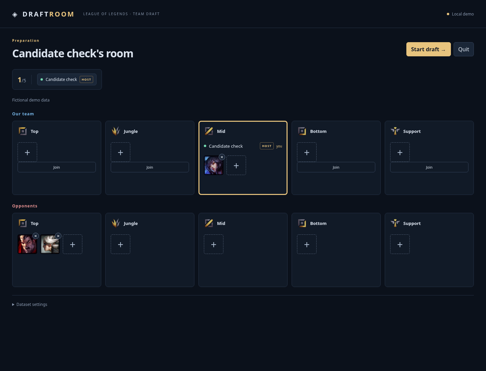
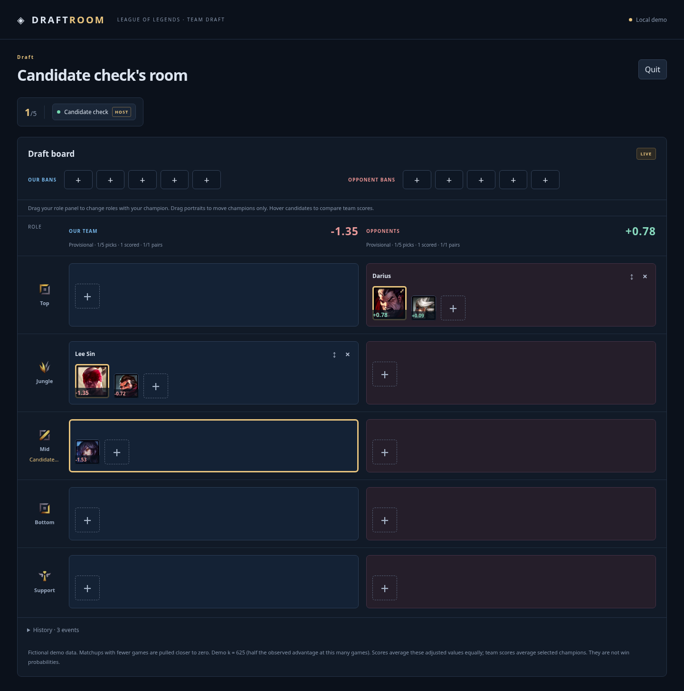

# Candidats pour les dix rôles

Décision confirmée le 15 novembre 2026 ; branche `feat/candidates-all-roles`. Chaque rôle allié et ennemi peut avoir une liste dans le lobby et pendant la draft, même sans participant. Ajouter, retirer ou préparer des candidats ne sélectionne aucun champion. En draft, un clic sélectionne un candidat, un autre le remplace, et un second clic sur le pick le désélectionne. [+] reste présent dans les dix cases ; les picks existants des anciennes salles restent visibles même sans liste.

## Propriété et prise de rôle

Le pool personnel existant reste la source de vérité d'un rôle allié incarné. Prendre un rôle remplace sa liste préparée par ce pool **sans fusion, même si le pool est vide**. Le remplacement est atomique et supprime la liste masquée : elle ne réapparaît pas lorsque le joueur repart. Le dernier pool du joueur reste alors disponible dans le poste libéré. Lors d'un échange, les pools suivent leurs propriétaires, avec les règles de consentement et de déplacement des picks existantes.

Les listes de rôles libres et ennemis sont partagées entre les membres. En préparation, modifier un pool personnel reste réservé à son propriétaire ou à l'hôte ; pendant la draft, les membres peuvent éditer les candidats comme auparavant. Les champions pris ailleurs ou bannis peuvent appartenir à une liste, mais restent indisponibles à la sélection. Un même champion peut être candidat à plusieurs rôles ; l'unicité des picks/bans reste obligatoire.

## Persistance et compatibilité

La migration **013** ajoute une RPC `set_role_candidates` et un trigger de validation/réconciliation. Elle n'efface ni ne transforme les salles existantes. Les listes libres sont conservées dans le champ optionnel `state.rolePools`, les pools personnels restent dans `players[].pool`. Aucun doublon d'autorité pour un rôle incarné : sa liste libre est retirée à l'arrivée du joueur.

La RPC contrôle l'appartenance, la version de la salle, le rôle, l'équipe et la liste (IDs textuels numériques, uniques, 500 maximum). Elle ne modifie pas les picks, bans ou statistiques. Une écriture préparée avant qu'un joueur prenne le poste est refusée comme obsolète. Le trigger s'applique aussi aux anciens chemins de sauvegarde, échanges et départs. Si un ancien client omet le champ optionnel, les listes présentes sont conservées. Les anciennes RPC restent opérationnelles.

Le cache statistique charge les fragments de toutes les listes, alliées et ennemies, en dédupliquant les clés champion/rôle. Les paires chargées et les métadonnées de cache ne sont toujours pas renvoyées dans les sauvegardes. La couverture de préparation inclut les dix listes. La formule de score, le shrinkage, le collecteur, les modèles immuables et la maintenance ne changent pas. Les listes étant dans la salle, elles suivent son expiration et sa suppression existantes.

## Validation

**96 tests TypeScript/PostgreSQL**, **23 parcours navigateur** et build TypeScript/Vite réussis localement. Les nouveaux tests couvrent les dix listes, la transition lobby/draft sans sélection automatique, l'override vide et non vide, le départ, les droits, les requêtes concurrentes, les charges invalides, la compatibilité avec un champ absent et l'hydratation dédupliquée des listes ennemies/libres. Le parcours navigateur couvre les dix cases, une prise de rôle, les candidats adverses multiples, la sélection/désélection, le retrait d'un candidat sélectionné sans effacement du pick, le rechargement et le mobile.

## Production vérifiée

Version **`2850a6c`** constatée sur Netlify le **15 novembre 2026 à 03:13 Europe/Zurich**. [CI de branche](https://github.com/NicoHelemon/lol_drafter/actions/runs/43666521418) et [CI de main](https://github.com/NicoHelemon/lol_drafter/actions/runs/43666762225) vertes, avec 96 tests TypeScript/PostgreSQL, 50 Python et 23 parcours navigateur. Sauvegarde privée préalable, application de la **seule migration 013**, puis une publication frontend groupée. Les deux salles existantes et leurs invitations sont identiques avant/après la migration et au contrôle final. Les 865 empreintes des fragments, le snapshot courant `603d125…`, les métadonnées et le modèle de calibration sont inchangés. Aucun secret modifié, aucune réinitialisation.

Recette réelle réussie entre **deux identités anonymes indépendantes** : préparation synchronisée des listes libres et adverses, prise de Mid avec pool personnel vide supprimant Ahri/Akali préparées, passage en draft sans sélection automatique, dix boutons [+] permanents, picks synchronisés, échange de rôles après consentement avec pools personnels suivant leurs propriétaires et listes partagées intactes, retrait de Lee Sin des candidats sans retrait du pick, rechargement et Quit supprimant uniquement les salles de test et leurs dépendances.

Le contrôle du score réel passe aussi : Renekton **+0,97**, équipe **+0,40**, remplacement par Camille **+0,27**, variation **−0,13**. Les navigateurs n'ont appelé aucun serveur Lolalytics. Preuves : [JSON](evidence/all-role-candidates-production.json), [lobby](evidence/ten-role-lobby-production.png), [draft](evidence/ten-role-draft-production.png).

Les preuves finales restent sur la branche dédiée sans nouveau déploiement uniquement documentaire. Aucun accès Riot, import OP.GG ou compte persistant ajouté : ces sujets restent au stade de discussion.
