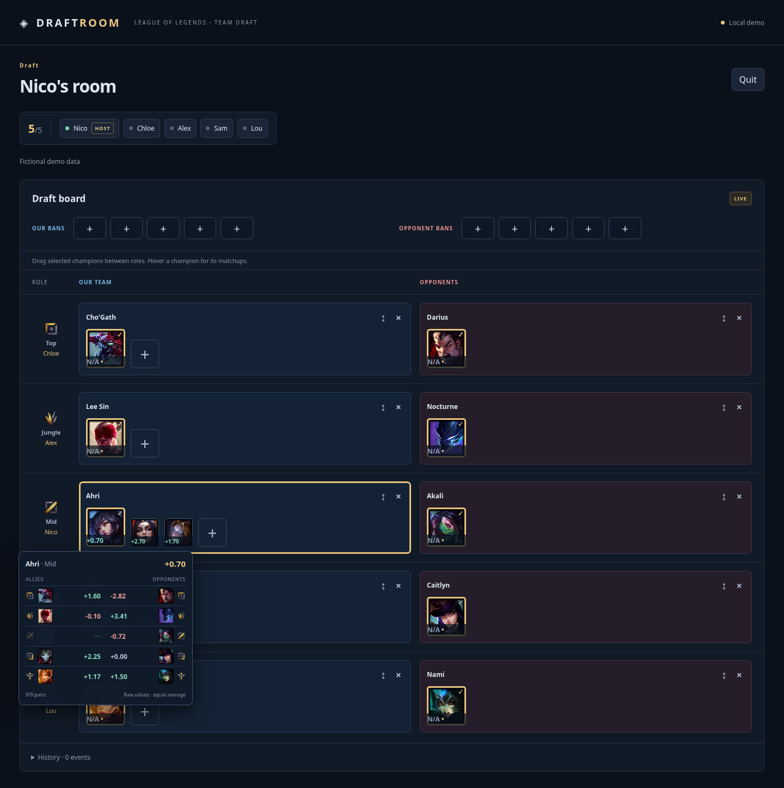
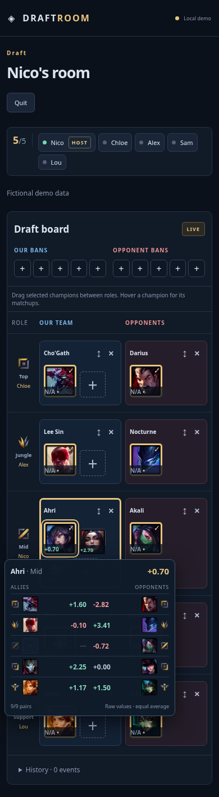
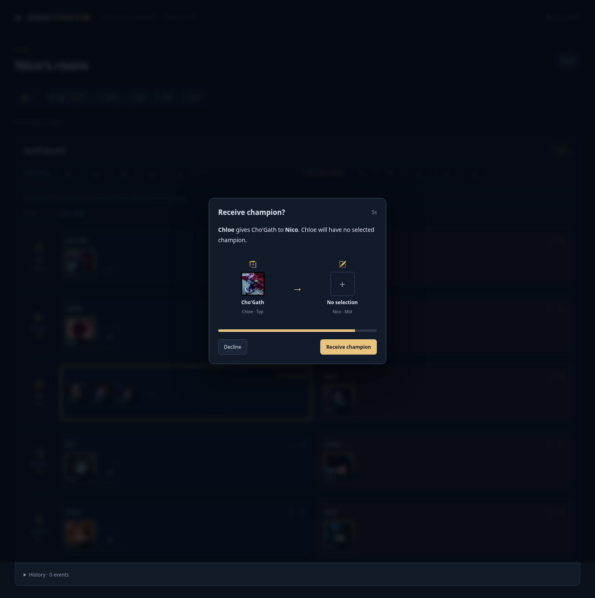

# Draft : déplacements, consentement et détail des scores

Demande utilisateur du 13 novembre 2026, branche `feat/draft-drag-swaps`.
Ce lot remplace les anciens poids Top/Support et le détail de score en popup.

## Présentation et calcul

Les sélections alliées conservent leurs dimensions : 72 px sur ordinateur,
58 px sur mobile. Les autres candidats et [+] passent à 52 px / 46 px.
Le pick choisi reste le premier, même si un candidat obtient un meilleur score.
Les dimensions côté ennemi sont conservées.

Tous les rôles et relations ont le même poids. En contexte complet, le score
est la moyenne arithmétique des neuf valeurs connues : cinq Against et quatre
Synergy. Les emplacements sans pick et les valeurs manquantes sont exclus de
la moyenne ; rien n'est remplacé par un faux zéro. Aucune observation connue
produit N/A. Un vrai zéro compte. Les deltas restent en points de pourcentage,
sans winrate de base, symétrie inventée ou changement des données collectées.

Le survol du portrait ou son focus clavier affiche un seul panneau compact,
sans cliquer sur le score. Il contient cinq lignes de rôles et deux colonnes :
alliés à gauche, adversaires à droite, depuis le point de vue du candidat.
Chaque relation montre l'icône de rôle, le portrait et la valeur brute ; la
colonne adverse est disposée en miroir. Vert : positif, rouge : négatif,
neutre : zéro, N/A : paire inconnue, tiret : emplacement vide. Le propre rôle
allié du candidat est grisé et exclu. Les neuf portraits possibles sont ainsi
alignés. Le panneau reste dans l'écran et Escape le ferme.

Les captures suivantes utilisent une **fixture synthétique**, sans valeur
présentée comme une statistique réelle de Lolalytics :





## Déplacement des champions sélectionnés

Un champion sélectionné peut être glissé sur un autre rôle de sa même équipe.
Un rôle vide reçoit le champion et libère le rôle d'origine ; un rôle occupé
intervertit les deux picks. Il n'y a plus de liste déroulante. Les équipes ne
peuvent pas être traversées par glisser-déposer. Les candidats non sélectionnés
restent des boutons de sélection, sans glissement.

Le bouton ↕ permet aussi de choisir puis de cliquer/toucher le rôle destinataire,
ou de le cibler au clavier avec Tab puis Enter/Espace. Escape annule.
Les cibles valides sont mises en évidence.

Pour deux rôles alliés incarnés, les sélections restent inchangées jusqu'à
l'accord des propriétaires. L'auteur du geste consent pour sa propre sélection ;
l'autre joueur accepte ou refuse dans un délai de cinq secondes, avec une barre
de temps comme dans le lobby. Si un tiers propose le mouvement, les deux joueurs
concernés doivent accepter. Une seule acceptation du tiers ne suffit pas.

Un destinataire sans pick voit « Receive champion? » : après son accord il
reçoit le champion, et le donneur n'a plus de sélection. Les rôles et les pools
restent liés à leurs propriétaires. Un champion reçu hors pool est affiché comme
pick sélectionné, selon la logique déjà existante.



## Protection serveur et livraison

La migration **009** ajoute `pick_swap_requests`, les RPC `move_draft_pick` et
`respond_pick_swap`, et les triggers de contrôle/nettoyage. RLS réserve les
lectures aux membres ; les clients ne peuvent pas écrire les approbations.
Les déplacements directs entre deux joueurs par `save_room` sont aussi bloqués
sans demande approuvée. Un indicateur client ne permet pas de contourner ce
contrôle. Les demandes sont consommées une seule fois et deviennent invalides
si les sélections changent, si un participant quitte la salle ou à expiration.
Les changements sans rapport avec les deux picks sont conservés.

Les suppressions de salles continuent de supprimer leurs demandes en cascade,
y compris lors de la maintenance existante. La migration n'efface aucune salle,
statistique ou identité et ne rejoue aucune ancienne migration.

Les tests SQL emploient PostgreSQL/PGlite ; les parcours navigateur locaux
emploient la démo et des identités explicitement synthétiques. Ils ne sont pas
présentés comme une validation Realtime du nouveau schéma Supabase hébergé.

La version `8b42026` a été publiée le 13 novembre 2026, après validation de la
branche et application de la seule migration 009. Les commits intermédiaires
ont été conservés sur la branche dédiée ; un seul push groupé a publié le
frontend, selon le feu vert de production donné par le propriétaire.
Recharger les anciens onglets pour utiliser les nouveaux contrôles.
Les preuves après publication sont conservées sur la branche de travail pour
éviter un nouveau déploiement Netlify uniquement documentaire.

## Validation

Validation locale : **70 tests TypeScript/PostgreSQL**, **17 parcours Playwright**,
**39 tests Python** et build TypeScript/Vite réussis. Les neuf nouveaux scénarios
SQL couvrent consentement, réception sans pick, double approbation d'une proposition
de tiers, refus/expiration, accès, contournement direct, changements concurrents
et suppression de la salle. Les six nouveaux parcours navigateur couvrent les
neuf contributions, tailles, hover/focus, zéros/manquants, glisser-déposer,
clavier, demandes et expiration. Aucun échec résiduel constaté.

Validation hébergée terminée le 13 novembre 2026 : [rapport de production](PRODUCTION_VERIFICATION.md)
et [preuves structurées](evidence/production-verification.json). Le calcul réel,
les échanges entre deux identités indépendantes, réception sans sélection,
refus et expiration passent. Les salles temporaires ont été supprimées ; les
865 fragments statistiques et le pointeur courant sont inchangés.

Le smoke test hébergé après publication est préparé pour la moyenne et le
survol. Avec les variables backend déjà configurées :

```sh
SUPABASE_PROJECT_REF=zsmpdkjfjqgtjinzoexv \
node scripts/statistics/verify_production.mjs work/draft-ui-production/score
```

Il lit le snapshot courant et ses observations canoniques côté backend, sans
transmettre le jeton de gestion au navigateur. Il ne relance pas la collecte.

Pour régénérer les captures de démonstration :

```sh
DRAFT_REVIEW_SCREENSHOTS=docs/ui/evidence \
PLAYWRIGHT_CHROMIUM_EXECUTABLE_PATH=/usr/bin/chromium \
npm run test:e2e -- tests/browser/draft-interactions.spec.ts
```
