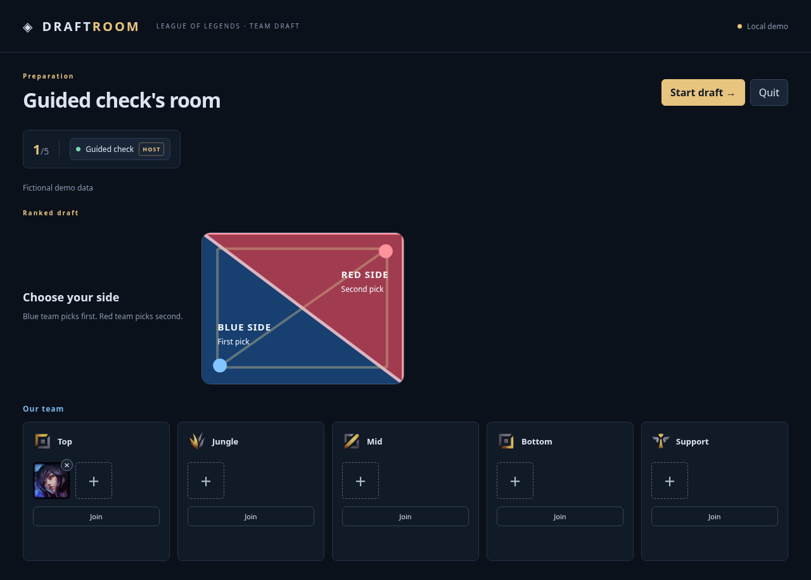

# Modes et progression manuelle

Demande du 15 novembre 2026. Branche `feat/guided-draft-modes`.

La création choisit l'un des deux boutons exclusifs **Ranked draft / Tournament draft**. Le lobby retire Dataset settings, couverture et import de fichier. Le camp allié se choisit sur une grande carte interactive : diagonale haut gauche → bas droite, bleu en bas à gauche, rouge en haut à droite. Le bleu prend le premier pick selon le schéma classique explicitement demandé. L'hôte choisit le camp ; les autres membres voient son choix synchronisé. Le lobby ranked ne permet aucune préparation des candidats ennemis, y compris via les API ; tournament conserve les dix listes.

## Séquences

- Ranked : les deux groupes de cinq bans se renseignent ensemble, puis picks **B1 → R2 → B2 → R2 → B2 → R1**.
- Tournament : bans **B R B R B R**, picks **B1 R2 B2 R1**, bans **R B R B**, picks **R1 B2 R1**.

Chaque groupe de deux picks doit être complet avant confirmation. L'hôte confirme manuellement les étapes ; aucun compte à rebours de draft. Les cases actives et les bans actifs sont signalés, avec une bannière décrivant précisément le tour. Les cases déjà confirmées gardent leur champion ; les réassignations de rôle et déplacements au sein d'une équipe restent possibles car ils conservent l'ensemble des champions. Le consentement existant reste obligatoire pour les échanges entre joueurs.

Previous step revient au groupe précédent pour correction, en retirant les choix d'étapes ultérieures. Il conserve les réassignations de rôles déjà consenties. Les bans vides peuvent être confirmés comme **no ban**. En ranked, un même champion peut être banni par les deux équipes, comme lors des bans simultanés ; un doublon au sein d'une équipe reste interdit. Les bans tournament sont uniques dans la draft.

## Candidats automatiques

Les dix cases de draft affichent au moins cinq choix disponibles, avec complément par popularité du rôle. Le pick actuel est premier, puis les candidats explicitement préparés ; les compléments automatiques suivent l'ordre de popularité et portent une petite étoile. Les candidats explicites indisponibles restent visibles mais n'empêchent pas le complément par cinq choix utilisables. Les suggestions automatiques ne modifient pas les pools enregistrés. Elles excluent les champions déjà pris ou bannis et se réajustent à chaque changement. Sans métadonnées de rôle suffisantes, le repli est alphabétique pour les places restantes, sans inventer de popularité.

Le cache charge aussi les statistiques des compléments automatiques. L'index des contributions est partagé entre les dix cases pour éviter de le reconstruire à chaque rôle. La formule des scores, le shrinkage, la collecte et les modèles restent inchangés.

## Protection et remise à zéro

Migration **014** : validation des bans ranked et trigger contrôlant mode, camp, étapes, historique des confirmations, droits de l'hôte et ensembles de picks/bans autorisés. Une sauvegarde générique ne permet pas de sauter le tour, de réécrire l'historique ni de remplacer un pick confirmé. Les contrôles s'appliquent aussi aux anciennes RPC de déplacements et d'échanges. Le mode est fixé à la création ; le camp est verrouillé au démarrage.

**Nouvelle autorisation utilisateur : les salles et joueurs temporaires peuvent être vidés/supprimés lors des mises à jour. Aucune rétrocompatibilité des salles n'est exigée.** Ce lot remet les salles à zéro au déploiement. Les statistiques Supabase, snapshots et calibrations sont conservés. Les identités Auth anonymes réutilisables ne sont pas des profils personnels persistants ; la suppression des salles supprime leurs membres, invitations et demandes associées.

## Validation

106 tests TypeScript/PostgreSQL, 25 parcours Playwright, build et diff-check réussis localement. Les 96 tests de base conservent leurs fixtures historiques isolées jusqu'à la migration 013 ; neuf nouveaux tests appliquent **toutes les migrations jusqu'à 014** pour contrôler les séquences complètes dans les deux camps, droits, contournements, doublons ranked, bans tournoi, corrections et consentement des rôles. Un test supplémentaire couvre l'hydratation statistique des compléments automatiques. Les parcours de scoring existants utilisent des états synthétiques isolés, tandis que les deux nouveaux parcours UI créent réellement les modes guidés et vérifient leur progression.

Ces images utilisent la démonstration fictive. Validation GitHub Actions et preuves hébergées consignées après observation. Aucun nouveau collecteur ni intégration Riot/OP.GG ajouté.
