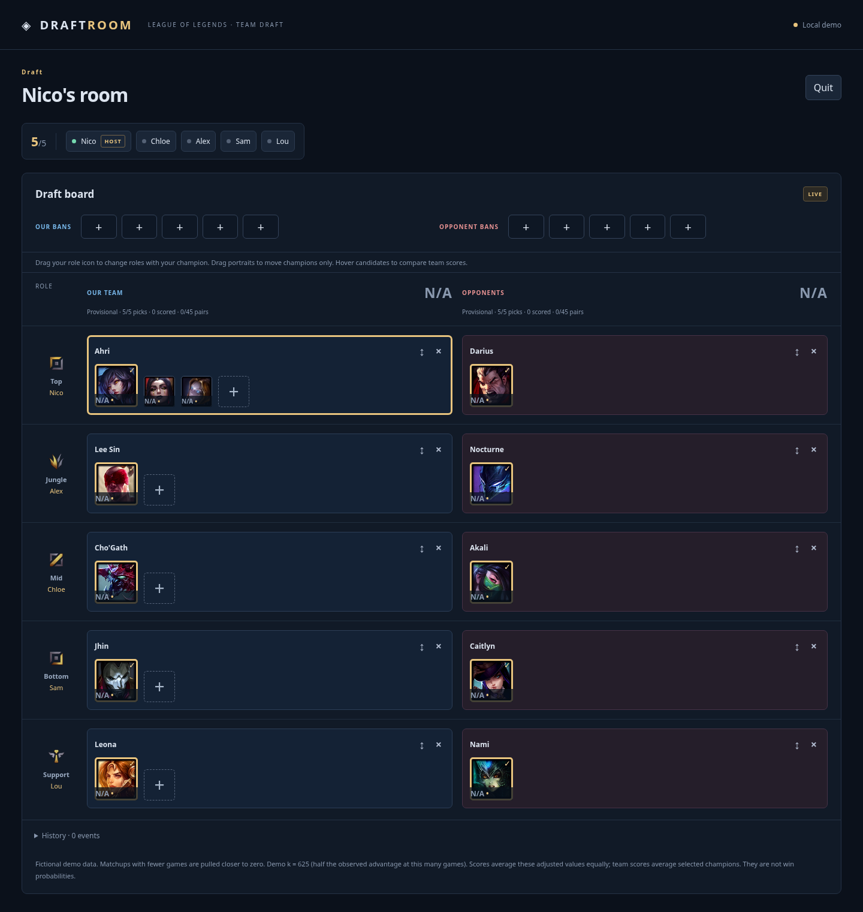
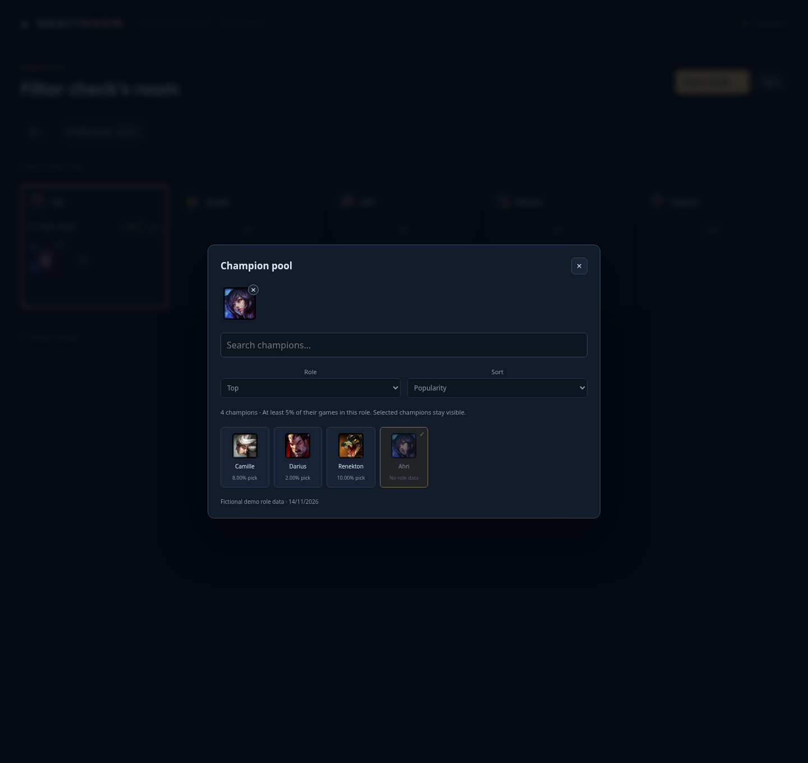
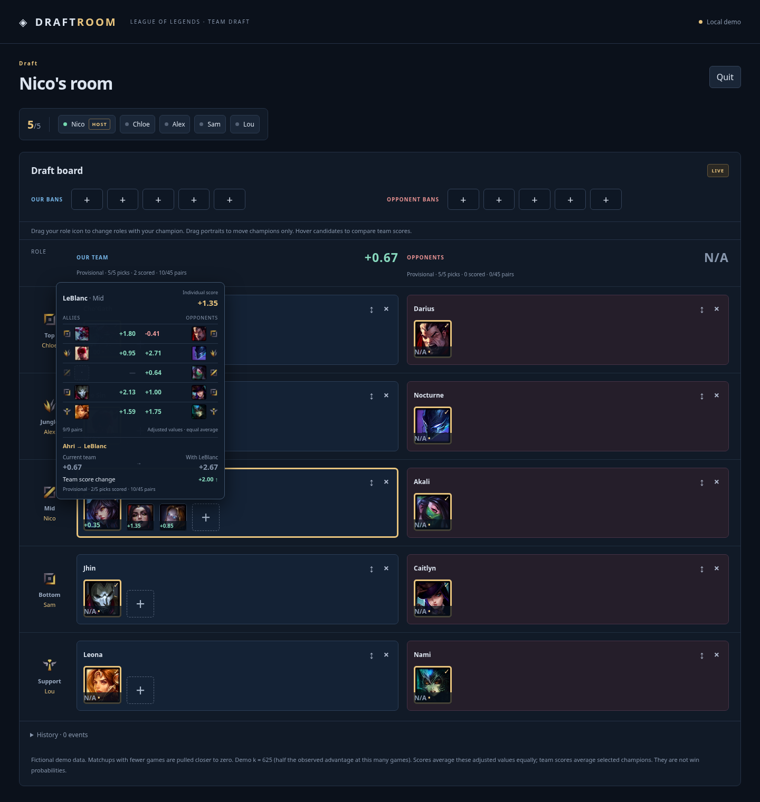

# Rôles pendant la draft et sélection des champions

Demande du 14 novembre 2026, branche dédiée `feat/draft-role-filters`. Les décisions ci-dessous complètent [DRAFT_INTERACTIONS.md](DRAFT_INTERACTIONS.md) et remplacent l'ancienne présentation des deux chiffres d'équipe. La capture d'écran de draft et les comptes/presets persistants restent hors périmètre.

## Échange de rôles

Le joueur glisse **sa propre icône de rôle** vers un autre poste. Clic/toucher puis cible, clavier et Escape permettent le même parcours. Entre deux joueurs, la demande existante Accept / Decline / Cancel est réutilisée : cinq secondes, expiration vérifiée côté serveur, aucun déplacement avant acceptation. Chaque joueur conserve son pool et son champion sélectionné. Une sélection vide suit aussi son propriétaire. Les rôles des adversaires restent fixes.

Vers un rôle sans participant, le déplacement est immédiat. Si ce poste contient déjà un pick anonyme, celui-ci revient dans le poste libéré. Glisser un **portrait** reste une opération différente : elle échange uniquement les champions selon les règles de consentement déjà présentes.

La migration **011** étend les demandes de rôle existantes, sans effacer les salles. Les RPC verrouillent la salle, contrôlent l'identité, la version, les rôles et les sélections au moment du consentement. Les demandes concurrentes de champion/rôle ne peuvent pas se chevaucher. Une sélection modifiée ou un départ invalide la demande concernée. Les triggers bloquent les changements directs et les approbations forgées ; les droits client ne permettent pas d'écrire les consentements.



## Filtre et popularité

Tous les sélecteurs communs aux pools, candidats, picks et bans proposent **Role** et **Sort**. Le filtre retient un champion lorsque **au moins 5 % de ses propres parties** se jouent dans ce rôle (`lanePercent`), plutôt qu'un seuil de popularité globale qui masquerait des champions peu joués. Le seuil reste une règle d'interface ; **aucun seuil ne filtre le corpus pairwise**. All roles garde les choix atypiques accessibles. Les champions déjà sélectionnés restent visibles même hors filtre ; la recherche textuelle s'applique toujours.

Dans un rôle, Popularity trie par nombre de parties dans ce rôle, avec le vrai `% pick` en complément. All roles trie par somme des parties **observées** dans le catalogue, libellées « recorded games » ; une donnée absente n'est pas inventée comme zéro. Le tri alphabétique reste disponible. Sans catalogue compatible, le sélecteur garde tous les champions par ordre alphabétique et explique l'absence de statistiques de rôles. La démo utilise des statistiques explicitement fictives.



### Provenance et actualisation

Source : pages publiques Lolalytics, **14 derniers jours, Emerald+, monde, Ranked Solo/Duo**, contexte identique au snapshot actuel (ne pas afficher Platinum+ pour ces données). Les champs `games`, `pr` et `pctLane`/`nav.lanes` viennent des structures Qwik des pages téléchargées, pas d'une approximation à partir des scores.

Les prochaines collectes complètes extraient ces métadonnées des **865 pages Build déjà nécessaires** : aucune requête supplémentaire par champion, salle ou survol. Le sidecar `role-catalogue.json` est validé et couvert par un SHA-256, puis publié dans la même transaction que le snapshot, sans modifier les observations, leur identité ni le k appris. La migration **012** ajoute une table immuable et lisible seulement par les utilisateurs authentifiés pour les snapshots prêts ; sa clé étrangère suit la rétention existante. Le navigateur garde ce petit catalogue en cache par snapshot.

Pour initialiser le snapshot déjà publié sans refaire la collecte, `role_catalogue.py` lit cinq pages publiques de tierlist, une par rôle. Les réponses fraîches du 14 novembre donnent **413 couples champion/rôle, couvrant les 173 champions**. Ces pages listent les rôles à partir de 2 % et 100 parties. Chaque champion a ici au moins **28 563 parties observées** : un rôle à 5 % dépasse donc largement 100 parties. Le filtre à 5 % est couvert ; les rôles sous les seuils de listing peuvent manquer dans cette initialisation. C'est pourquoi le total tous rôles est décrit comme « recorded games ». Les collectes suivantes produisent les 865 entrées sans ce filtre de listing. Le bootstrap échoue si les champions ou volumes ne garantissent plus la couverture du filtre.

Les fixtures réelles réduites de `tests/statistics/fixtures/role-catalogue` vérifient les noms de champs et filtres. Elles ne constituent pas une nouvelle comparaison indépendante de chaque ligne avec le DOM.

```sh
# Lecture seule par défaut ; réutilise le cache de réponses fraîches.
python3 scripts/statistics/role_catalogue.py --output work/role-catalogue
# Après migration 012 seulement, ajout au snapshot courant sans remplacement :
SUPABASE_PROJECT_REF=zsmpdkjfjqgtjinzoexv \
python3 scripts/statistics/role_catalogue.py --output work/role-catalogue --apply
```

## Comparaison des scores

Le haut du survol porte **Individual score**. Un candidat affiche ensuite le remplacement, par exemple **Aatrox → Renekton**, les valeurs **Current team → With Renekton**, puis **Team score change** avec signe et flèche. Pour un rôle vide, « Add Renekton · Top » précise l'ajout. Les moyennes, le shrinkage, le recalcul des autres alliés et les règles N/A ne changent pas.



## Validation et livraison

Validation locale réussie : **88 tests TypeScript/PostgreSQL**, **50 tests Python**, **22 parcours Playwright**, build TypeScript/Vite et `git diff --check`. Les nouveaux scénarios couvrent consentement, refus, annulation, expiration, rôles libres, sélection vide, concurrence, accès et contournements SQL ; les parcours navigateur couvrent glisser-déposer, clavier, filtres lobby/draft, sélection hors rôle, comparaison et mobile à 390 px. Les tests locaux SQL/PGlite et démo ne prouvent pas à eux seuls la synchronisation Supabase hébergée.

Livraison : validation GitHub Actions, sauvegarde et contrôle des empreintes des données avant les seules migrations 011–012, ajout du catalogue puis une publication frontend groupée selon le feu vert de production déjà donné. Les preuves hébergées seront ajoutées après observation, sur la branche de travail sans déclencher un second déploiement uniquement documentaire.
