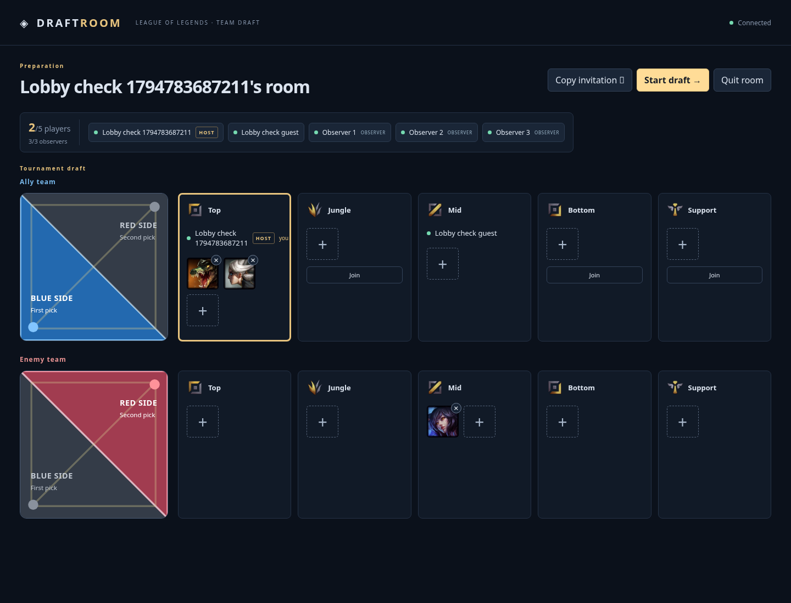

# Retours de draft et observateurs

Demande du 15 novembre 2026. Branche `feat/lobby-observers`. Ces règles remplacent l'irréversibilité décrite dans [OPEN_DRAFT_HISTORY.md](OPEN_DRAFT_HISTORY.md).

## Navigation et confirmations

Les textes « No account required · up to five players » et « Demo statistics are fictional. » sont retirés de l'accueil. La provenance réelle ou fictive des statistiques reste indiquée dans la note de draft.

Après activation d'Open draft, le bouton **Guided draft** apparaît à sa place. Une confirmation précise que les picks, bans et piles Undo/Redo seront effacés. Accepter redémarre le mode ranked/tournament choisi à la création, au début des bans. Les participants, rôles, candidats, camp et référence statistique restent identiques. Annuler la popup ne change rien. Ce redémarrage ne peut pas être annulé par Undo.

**Return to lobby**, réservé à l'hôte pendant la draft, ramène toute la salle en préparation après confirmation. Picks, bans et historique sont effacés ; membres, rôles et candidats alliés restent. En tournament, les candidats ennemis restent aussi. En ranked, les candidats ennemis sont effacés pour préparer une nouvelle partie, conformément à l'absence de préparation ennemie dans ce lobby. Le mode libre est désactivé et l'hôte peut lancer une nouvelle draft.

**Quit room** quitte personnellement la salle, sans réinitialiser la draft des autres membres. Si l'hôte quitte, la transmission privilégie un joueur plutôt qu'un observateur. La dernière sortie supprime la salle et son historique privé. Clear et son Undo conservent leur fonctionnement précédent.

## Cinq joueurs et trois observateurs

L'invitation propose **Player / Observer**. Les quotas sont distincts : cinq joueurs, trois observateurs, huit personnes au maximum. Les joueurs rejoignent en préparation ; les observateurs peuvent aussi rejoindre une draft en cours. L'invitation reste obligatoire et les compteurs/étiquettes distinguent les deux catégories.

Un observateur ne peut pas occuper un rôle, avoir un pool personnel, éditer les candidats, pick/ban ou déplacer les champions. Il peut suivre les mises à jour, consulter les scores, renouveler sa présence et quitter. Le type choisi est fixe pour cette participation ; il faut quitter puis rejoindre pour changer de catégorie. L'hôte conserve ses droits de gestion si la salle lui est transmise alors qu'il était observateur.

L'arrivée ou la sortie d'un observateur ne supprime pas l'historique Undo/Redo des joueurs. Les affectations de joueurs et échanges consentis restent les bases de cet historique. Les données de parties ne sont pas copiées dans les places supplémentaires.

## Serveur et validation

Migration **017**, appliquée après 016. `join_room` reçoit `as_observer` et vérifie quotas, invitation et phase dans une transaction verrouillée. Une validation empêche de forger ou changer la catégorie via une sauvegarde générique. Les huit RPC de modification vérifient le droit d'éditer avant leur logique existante ; les contrôles de consentement, rôle et version restent conservés. Les observateurs restent autorisés en lecture par les politiques de membres existantes.

Les actions hôte `guided` et `lobby` utilisent le contrôle transactionnel privé déjà présent. Elles effacent les piles et demandes d'échange et publient une seule nouvelle version. Un client ne peut pas désactiver le mode libre ou revenir au lobby par une écriture arbitraire.

122 tests TypeScript/PostgreSQL, 50 Python et build passent localement. Les nouvelles vérifications couvrent restart guidé, retour lobby ranked/tournament, conservation des listes, quotas 5+3 et débordements, arrivée d'observateurs en cours de jeu sans perte d'Undo, accès en lecture/présence/sortie, refus des huit RPC d'édition, catégories non falsifiables et transmission d'hôte. Les nouveaux parcours navigateur couvrent aussi les deux confirmations (annulation et acceptation), le rechargement, le redémarrage et l'interface d'observation.

La remise à zéro des salles temporaires aux mises à jour reste autorisée, sans rétrocompatibilité. Snapshots, fragments, modèles, catalogue, secrets et collecteur sont préservés. Les preuves de livraison figurent ci-dessous.

## Livraison vérifiée

Version **`07f9a0c`** observée en production le **16/11/2026 à 00:03 Europe/Zurich**. [CI de branche](https://github.com/NicoHelemon/lol_drafter/actions/runs/43771170228) et [CI de main](https://github.com/NicoHelemon/lol_drafter/actions/runs/43771529796) vertes : **122 tests TypeScript/PostgreSQL, 50 Python, 29 parcours navigateur et build**.

Seule la migration 017 a été appliquée après sauvegarde privée et vérification du projet Supabase. Les **quatre salles temporaires**, leurs sept membres, quatre invitations et quatre piles privées ont été supprimés conformément à la consigne de livraison. Les identités Auth anonymes réutilisables ne sont pas supprimées. Après migration **et après recette**, les empreintes des **865 fragments**, le snapshot courant, le modèle et le catalogue sont inchangés.

Ranked et tournament ont été vérifiés avec **cinq sessions indépendantes** : deux joueurs et trois observateurs. Les observateurs ont rejoint la draft déjà commencée ; leurs éditions sont désactivées dans l'interface et une tentative d'écriture authentifiée a été refusée par le serveur. Une sixième session a confirmé le refus d'une quatrième place d'observateur. Arrivée/sortie d'observateurs sans perte d'Undo, confirmations annulées puis acceptées, reprise guidée à zéro, retour partagé au lobby, conservation des rôles/listes/snapshot, relance d'une nouvelle draft et distinction entre sortie personnelle et dernière sortie supprimant la salle : réussis. Les salles de recette et leurs piles privées ont été nettoyées.

La recette des statistiques réelles passe aussi : Renekton Top **+0,97**, équipe **+0,40**, remplacement Camille **+0,27**, k **2510,0480**, conservés après rechargement. Aucun appel direct à Lolalytics depuis les navigateurs, aucun secret ni collecteur modifié.

[Preuve structurée](evidence/lobby-observers-production-verification.json). Ce constat est sauvegardé sur la branche de travail sans seconde publication de production pour le seul ajout documentaire.
