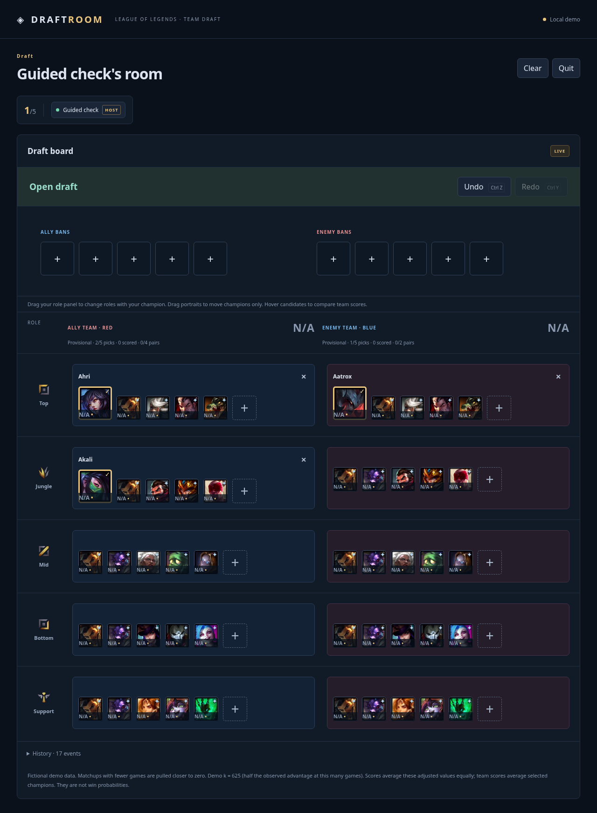

# Undo / Redo, Open draft et ordre des candidats

Demande du 15 novembre 2026. Branche `feat/open-draft-undo`. Remplace les règles de correction et de classement des documents antérieurs.

## Utilisation

Les boutons de déplacement ↕ et les croix de retrait des picks/bans disparaissent de la draft guidée. Les échanges de champions et de rôles passent par glisser-déposer ; les demandes de consentement existantes sont conservées. Les croix des listes de candidats restent disponibles pour éditer ces listes.

**Undo / Redo**, avec **Ctrl + Z / Ctrl + Y**, remplacent Previous step. L'hôte contrôle cet historique commun ; les choix des invités y figurent aussi. Un Undo annule **un choix**, pas nécessairement un tour entier : annuler le deuxième pick d'un tour double conserve le premier. Redo rétablit exactement ce choix et la progression qui l'accompagnait. Les piles sont conservées après rechargement, synchronisées entre navigateurs et un nouveau choix efface Redo. Les raccourcis laissent les champs de saisie et les fenêtres de sélection gérer leur propre édition.

**Open draft**, près de Clear / Quit pour l'hôte, conserve tous les choix présents et enlève les contraintes de tour. Les deux équipes peuvent ensuite sélectionner/remplacer/enlever des picks et bans dans n'importe quel ordre. Les doublons, limites de cinq et consentements restent contrôlés. Les croix de retrait réapparaissent ici ; aucun bouton de swap n'est réintroduit.

**Le passage à Open draft est définitif.** Il vide les piles Undo/Redo et établit une nouvelle base. Ensuite Undo/Redo portent sur les choix effectués en mode libre ; ils ne peuvent jamais réactiver la séquence guidée. Clear reste en mode libre et peut être annulé s'il a effacé des choix. Dans les deux modes, Clear conserve rôles, membres, candidats et référence statistique.

Un échange de rôle/champion ou un changement de participants établit également une nouvelle base d'historique. On ne restaure ainsi pas d'anciennes affectations de joueurs sans consentement. Les modifications des listes de candidats ne sont pas annulées et n'effacent pas l'historique des picks/bans.

## Classement

Dans chaque case de draft, tous les champions sont triés par **score Delta 2 ajusté décroissant**, indépendamment du statut explicite/automatique, de la popularité, du statut disponible/bloqué ou de la sélection courante. Le pick reste reconnaissable par sa taille et son cadre ; il n'est pas forcé en tête. Les valeurs manquantes sont en dernier, les égalités départagées par nom. Le calcul n'utilise pas les arrondis d'affichage pour trier.

La popularité sert toujours à constituer le complément d'au moins cinq candidats. Les filtres/tri du catalogue de recherche restent ceux demandés précédemment. Aucun score, modèle ni observation statistique n'est modifié.

Capture locale avec données de démonstration fictives.

## Stockage et contrôles

Migration **016**, après 015. Les positions d'historique contiennent uniquement picks, bans et progression. Les statistiques, pools, joueurs et camp ne sont pas copiés dans ces positions. Deux piles privées limitées à **60 actions** par salle sont enregistrées dans `draft_timelines`, avec suppression en cascade à l'expiration/suppression de la salle. Seuls les compteurs sont exposés dans la ligne de salle.

La RPC `control_draft` vérifie appartenance, hôte et version, verrouille la salle, restaure une position réellement enregistrée par le serveur, puis publie une seule nouvelle version. Un jeton interne de restauration reste dans la table privée, inaccessible aux membres ; aucun paramètre client ne permet de désactiver les contrôles. Les triggers de consentement restent actifs. Toute erreur annule la transaction et son jeton. L'irréversibilité d'Open draft est contrôlée avant la restauration.

## Vérification et livraison

117 tests TypeScript/PostgreSQL, 50 Python et build réussis localement. Les contrôles ajoutés couvrent annulation/rétablissement d'un choix, frontières de tours doubles, invalidation de Redo, conservation des pools, droits/versions, confidentialité de la pile, mode libre irréversible, Clear annulable, nouvelle base après échanges, limite de stockage et classement selon les scores ajustés. Les résultats des 27 parcours navigateur et de la vérification hébergée sont ajoutés après exécution.

La livraison suit l'autorisation permanente : remise à zéro des salles temporaires après vérification/sauvegarde, sans rétrocompatibilité des salles. Données statistiques, secrets et collecte sont préservés.
