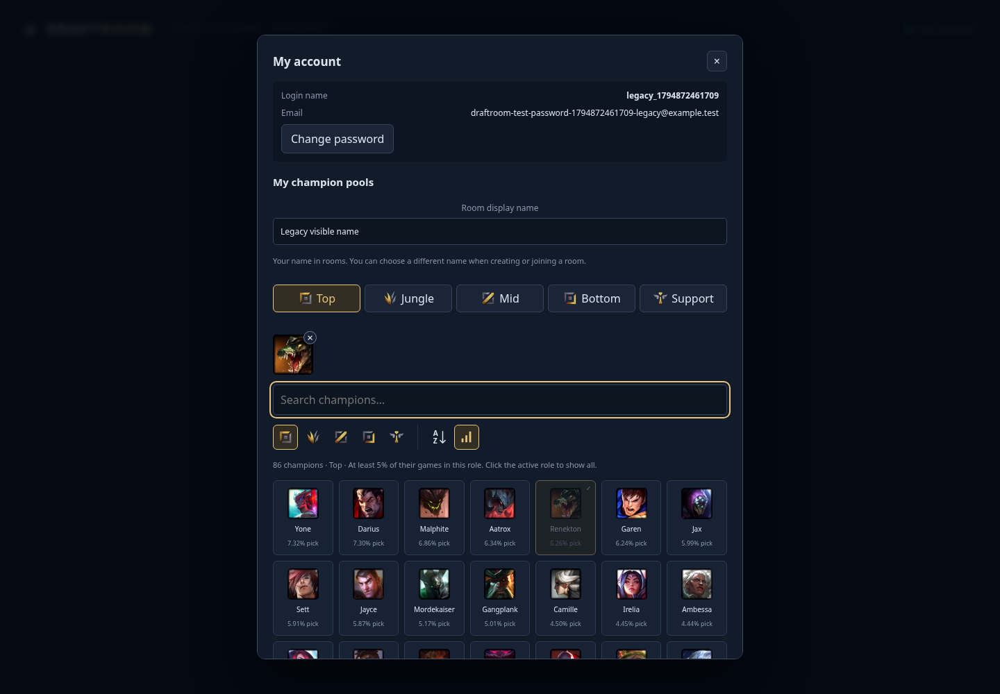

# Comptes avec pseudo de connexion et mot de passe

Demande du 17 novembre 2026 (Europe/Zurich), branche `feat/password-accounts`, migration 019. Cette évolution remplace la connexion habituelle par code de la livraison 018 ; les profils, listes personnelles et règles de salles sont conservés.

## Identité et parcours

Trois informations distinctes : **login name**, pseudo privé de connexion unique de 3 à 24 lettres ASCII, chiffres ou underscores, insensible à la casse ; **email**, associé au compte et vérifié ; **room display name**, nom affiché aux membres des salles. Le dernier peut contenir espaces et accents, n’est pas nécessairement unique et reste modifiable au profil ou ponctuellement à la création/entrée d’une salle. Changer le nom de salle ne change pas le pseudo de connexion ni le nom par défaut du profil.

Les nouveaux comptes renseignent les trois informations et un mot de passe d’au moins dix caractères (maximum 128 dans l’interface). Le mot de passe doit être confirmé. Un code email confirme l’inscription une seule fois. Les visites suivantes utilisent le pseudo privé **ou l’email**, avec le mot de passe ; la session reste conservée dans ce navigateur. La fenêtre de confirmation propose de renvoyer le code si nécessaire. Les comptes restent facultatifs, les invités restent disponibles.

Les comptes existants gardent le même identifiant Supabase, la même adresse, le même profil et les cinq listes. S’ils sont déjà connectés, **My account** affiche **Finish setting up your account** : choisir le pseudo privé et définir le premier mot de passe. S’ils sont déconnectés, **Existing email-code account? Set your first password** envoie un code de récupération sur leur adresse actuelle, puis ouvre la même étape. **Forgot password?** suit ce parcours de récupération ; un compte déjà configuré garde son pseudo pendant la réinitialisation. Aucun compte ni pool n’est recréé par la migration.

La connexion, la définition des identifiants et les réglages restent hors salle. Le profil reste accessible à son propriétaire ; l’enregistrement explicite d’un pool depuis la salle conserve son fonctionnement. Les mots de passe ne sont ni stockés dans les profils, ni conservés dans le navigateur par le code applicatif, ni consignés dans les traces applicatives. Supabase Auth assure leur stockage et leur vérification.

## Résolution du pseudo

`account_logins` relie chaque compte à un pseudo privé unique. Ni la table ni la résolution email ne sont lisibles depuis les clients. `my_account_login` renvoie uniquement les réglages du compte courant, dont la présence d’un mot de passe ; `set_my_login_name` exige un compte vérifié, un mot de passe défini et aucune participation en salle. `login_name_available` expose seulement la disponibilité d’un pseudo, sans email ni profil associé.

La fonction Supabase **account-password-login** est publique pour accepter une connexion sans session préalable (`verify_jwt=false`). Elle valide la requête, applique une limitation de trente tentatives par adresse client hachée sur dix minutes, puis résout le pseudo via un RPC réservé à `service_role`. Les emails peuvent aussi être transmis directement. Elle demande ensuite à Supabase Auth de vérifier le mot de passe et retourne seulement les deux jetons nécessaires à la session. Les erreurs de pseudo inconnu et de mauvais mot de passe ont le même message. Aucun annuaire pseudo/email n’est renvoyé.

Les seules clés de cette fonction sont les variables serveur intégrées Supabase ; aucune nouvelle clé administrative dans le frontend ou secret Netlify. CORS est limité au domaine de production et aux ports locaux de développement. Les réponses ne sont pas mises en cache. La table de limitation ne contient ni mot de passe, ni email, ni adresse IP en clair et ses anciennes lignes expirent au prochain appel.

Lors d’une nouvelle inscription Auth, un trigger réserve le pseudo dans la transaction de création et initialise un profil avec le nom d’affichage et cinq listes vides. Deux inscriptions ne peuvent pas obtenir le même pseudo, même en concurrence. Ce trigger laisse les anciens comptes et les identités anonymes intacts. Les mots de passe sont définis via l’API Auth, jamais via un SQL applicatif.

## Déploiement et validation

Appliquer seulement 019 après sauvegarde des identités/profils existants et empreintes statistiques. Aucune suppression de salles requise pour cette évolution. Déployer le dossier `supabase/functions/account-password-login` (entrée `index.ts`, `verify_jwt=false`), puis publier le frontend après CI. Les emails de confirmation et de récupération affichent `{{ .Token }}` ; expiration dix minutes. Configurer `password_min_length=10` dans Auth ; conserver les identifiants SMTP, le fournisseur et les paramètres de sessions existants.

Les tests SQL couvrent la migration des comptes existants, les champs séparés, l’unicité insensible à la casse, la réservation transactionnelle à l’inscription, la confidentialité, le refus des comptes non vérifiés, les changements hors salle et l’expiration des limites. Les tests du handler vérifient erreurs génériques, réponses sans secret, validation et débit. Les tests navigateur couvrent connexion normale persistante, nom ponctuel de salle, inscription et confirmation, premier mot de passe depuis une session existante ou une récupération, réinitialisation et mode invité.

La recette hébergée doit créer seulement des comptes réservés de test sans envoi d’email, vérifier les mots de passe réels et la conservation des deux comptes utilisateurs. Cela ne prouve pas la réception d’un vrai message Brevo. Statut de livraison et preuves à ajouter après constat.

## Livraison constatée

Version **`4209425`** observée sur Netlify le **17 novembre 2026 à 00:39 Europe/Zurich**. CI de [branche](https://github.com/NicoHelemon/lol_drafter/actions/runs/43980742971) et de [main](https://github.com/NicoHelemon/lol_drafter/actions/runs/43981130114) vertes : **140 tests TypeScript/PostgreSQL, 50 Python, 36 parcours navigateur et build**. Une seule publication de production du lot ; ces preuves sont ensuite sauvegardées sur la branche de travail.

Seule la migration 019 a été appliquée après sauvegarde privée et vérification du projet Supabase. La fonction `account-password-login` est active (version 1, empreinte du handler dans les preuves). Le minimum de dix caractères et les modèles de confirmation/récupération ont été vérifiés via l’administration Auth ; aucun identifiant SMTP, secret GitHub ou clé Netlify modifié. Aucune suppression des salles existantes requise.

Après migration **et après recette**, les deux comptes préexistants conservent leurs identifiants, adresses, état de confirmation et empreintes de mots de passe ; leurs deux profils, noms, versions et cinq listes sont strictement inchangés. Les **865 fragments statistiques**, le pointeur courant, le modèle et le catalogue sont identiques à la sauvegarde.

La recette réelle utilise deux comptes temporaires réservés, sans envoi d’email. Un compte simulant l’ancien fonctionnement reçoit un profil avec Renekton Top et Ahri Mid, puis utilise un code de récupération généré par l’administration Auth. Il définit son pseudo privé et son premier mot de passe dans l’interface, garde son identifiant et son profil à la même version, puis se connecte réellement par pseudo en majuscules ou par email. La réinitialisation garde son pseudo et ses listes ; l’ancien mot de passe est refusé et le nouveau fonctionne. La session survit au rechargement.

Pour la nouvelle inscription, seule la demande d’envoi vers l’adresse réservée est interceptée ; l’administration Auth génère une inscription réelle avec mot de passe et métadonnées, sans envoyer de message. Le trigger réserve le pseudo et initialise le profil. Le code de confirmation est vérifié réellement ; la connexion suivante par pseudo/mot de passe utilise la fonction hébergée et Auth réels. Un pseudo déjà pris est refusé avant l’inscription. La table privée et son RPC de résolution refusent l’accès du second compte. Cette recette ne prouve pas le transport d’un message par Brevo.

Sur ordinateur et à 375 px, le profil est utilisable et la fenêtre défile. Un nom ponctuel de salle différent conserve le compte et son nom par défaut ; prendre Top charge Renekton depuis le profil, puis quitter la salle ne change ni le nom ni la version personnelle. Les deux seuls comptes de recette créés pour ces vérifications sont supprimés, avec leurs profils. Aucun appel Lolalytics depuis les navigateurs.

Le contrôle des statistiques réelles réussit : Renekton **+0,97**, équipe **+0,40**, aperçu Camille **+0,27**, conservés après rechargement.

[Preuves structurées](evidence/password-accounts-production-verification.json) · [Vue mobile](evidence/password-accounts-mobile.png).
