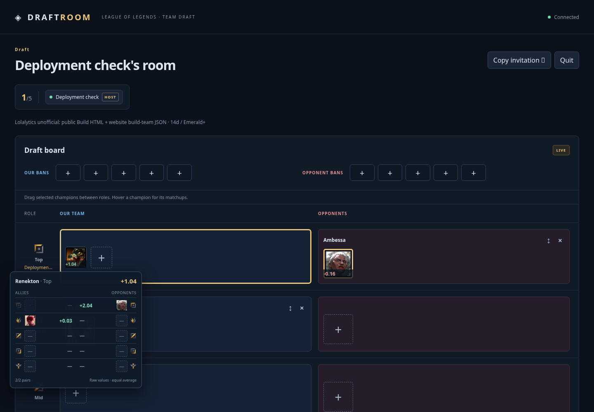

# Vérification de production — 13 novembre 2026

Version publiée : [`8b420263`](https://github.com/NicoHelemon/lol_drafter/commit/8b420263eccf0abb9da6585dec3e2c308d89937e).
Le site [draftroom-lol.netlify.app](https://draftroom-lol.netlify.app) expose ce
commit dans `deployment.json`, build du 13 novembre à 16:50:27 UTC.
La migration additive 009 a été appliquée avant publication du frontend.
Un seul push groupé a publié cette version sur `main`.

## Tests automatisés

- 70 tests TypeScript/PostgreSQL/PGlite : réussis.
- 17 parcours navigateur Playwright : réussis.
- 39 tests Python de collecte/publication : réussis.
- Build TypeScript/Vite : réussi.
- [CI de la branche](https://github.com/NicoHelemon/lol_drafter/actions/runs/43466003874) et
  [CI de main](https://github.com/NicoHelemon/lol_drafter/actions/runs/43466704656) : réussies.

## Score sur les données réelles

Une salle privée temporaire utilise le snapshot courant
`4370fedbdc719312b56f2cdd3db07ffa8edc16b28519d3bda69edaf0a46967ce`.
Pour Renekton Top candidat, les deux observations canoniques sont Against
Ambessa Top (+2,04) et Synergy Lee Sin Jungle (+0,03). La moyenne est affichée
**+1,04**, identique au calcul indépendant côté backend.

Le panneau au survol présente les deux deltas bruts et `2/2 pairs`.
Le score est conservé après rechargement. Quatre lectures de fragments Supabase
ont été observées ; aucune requête navigateur vers Lolalytics et aucune paire
statistique embarquée dans l'état persistant de la salle. La salle a été quittée.

## Échanges entre deux joueurs

Deux contextes Chromium indépendants ont créé et rejoint une autre salle
privée via invitation, avec deux identités anonymes distinctes : Top et Mid.
Les contrôles portent sur le frontend publié et les RPC Supabase hébergées.

- Glisser Renekton Top sur Ahri Mid laisse les deux sélections inchangées
  jusqu'à l'accord du second joueur, puis intervertit les champions.
- Les rôles, propriétaires, pools et métadonnées du dataset restent inchangés.
- Après libération de Mid, recevoir Ahri depuis Top laisse Top sans sélection.
- Refuser la proposition de retour conserve les sélections.
- Laisser expirer une nouvelle proposition après cinq secondes conserve aussi
  les sélections et ferme les demandes dans les deux sessions.
- Le rechargement conserve l'état final.
- Quitter les deux sessions supprime la salle et ses membres, invitation,
  demandes de rôles et demandes de champions. Vérification serveur : zéro reste.
- Aucune requête navigateur vers Lolalytics.

Deux essais préparatoires ont nécessité des corrections du script de contrôle :
attendre la synchronisation des pools avant une autre écriture, et inclure la
flèche dans le libellé du bouton Start draft. Leurs salles temporaires ont été
nettoyées. Aucun correctif du produit ni second déploiement n'a été nécessaire.
Le parcours complet décrit ci-dessus a ensuite réussi.

## Préservation des données

Projet Supabase vérifié `ACTIVE_HEALTHY` avant migration. Sauvegarde privée
compressée et protégée dans l'espace de travail avant toute modification.
Seule la migration 009 a été exécutée ; aucune ancienne migration rejouée.

Les empreintes SHA-256 des **865 fragments statistiques** sont identiques avant
migration, après migration et après les tests hébergés. Le snapshot courant,
ses métadonnées et la salle préexistante sont préservés par la migration.
Le contrôle final à 16:54:41 UTC retrouve une salle, comme avant les tests, et
aucune demande d'échange de champions restante.

Les RPC de déplacement/réponse sont accessibles aux membres authentifiés ;
`anon` ne peut pas les exécuter. Les clients authentifiés ne peuvent pas insérer
directement de demande ni écrire leurs approbations.
Le collecteur et les données Against/Synergy n'ont pas été modifiés.

Les [preuves JSON](evidence/production-verification.json) ne contiennent ni jeton
d'authentification ni lien d'invitation. Ce rapport et les preuves sont conservés
sur `feat/draft-drag-swaps`, après le commit publié, pour éviter un déploiement
Netlify supplémentaire uniquement documentaire.
