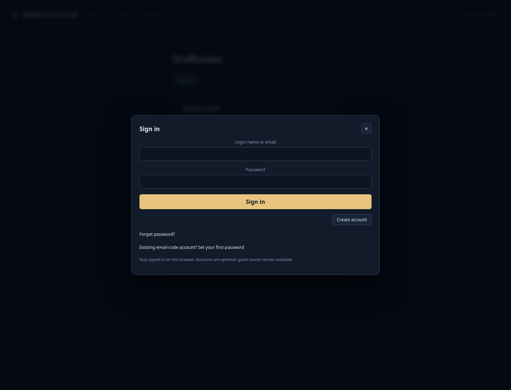
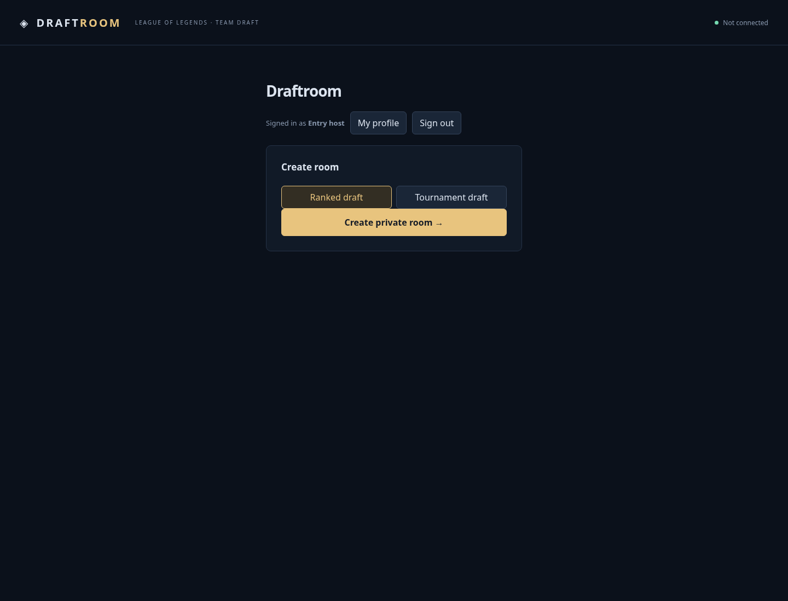
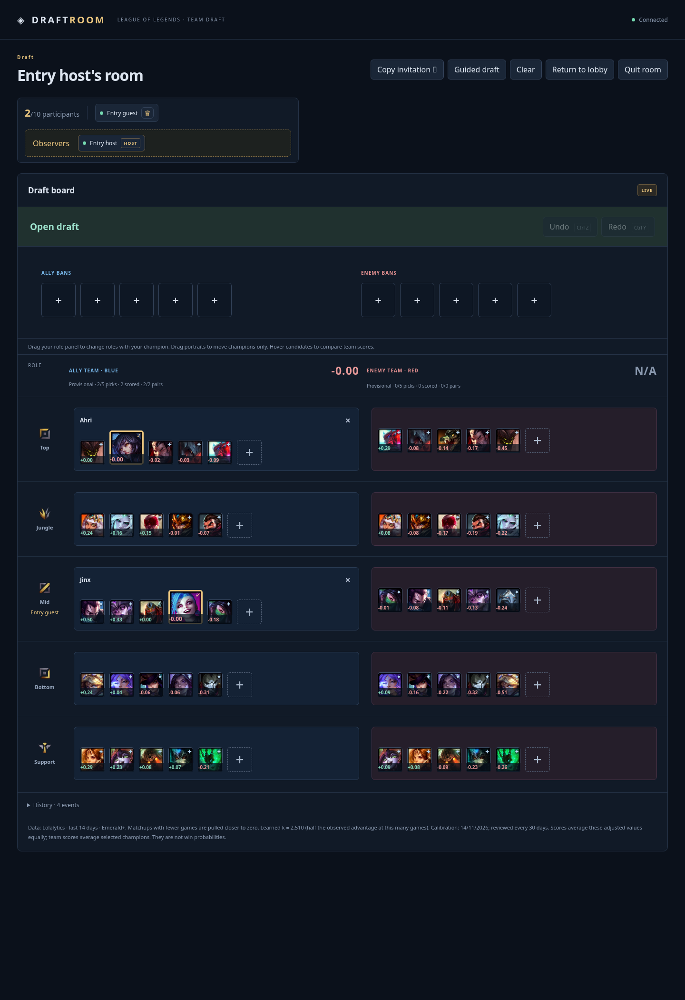

# Accueil, première configuration et zone observateurs

Demande du 17 novembre 2026. Branche `feat/profile-onboarding-observers`, migration 020. Les comportements décrits ici remplacent les parties correspondantes des livraisons 018 et 019.

## Accueil et profil

Un visiteur invité garde le formulaire de salle avec Display name et peut choisir de se connecter via **Sign in**. La popup contient le formulaire de connexion principal et un petit bouton secondaire **Create account**, sans les deux onglets de même taille. Une connexion réussie ferme la popup et laisse l’accueil prêt à créer ou rejoindre la salle.

Pour un compte connecté, le nom d’affichage est celui du profil : le formulaire de salle ne le redemande plus. **My profile** ouvre volontairement les réglages du nom, du compte et des cinq listes. Les noms du profil et de connexion restent distincts. Modifier le profil ne renomme pas les salles et participants déjà créés.

Une nouvelle inscription confirme son email, puis prépare une première fois les candidats par rôle. Les rôles inutilisés peuvent rester vides. `user_profiles.onboarding_complete` persiste cette étape : false uniquement pour les nouvelles inscriptions, true au premier enregistrement explicite du profil. Une préparation interrompue reprend au rechargement ou à la connexion suivante. Le formulaire de salle attend cette préparation ; quitter la popup laisse l’accès à My profile et à la déconnexion.

Les profils existants reçoivent true par défaut sans modifier leurs noms, listes, versions ou dates. Ils ne repassent pas par la configuration initiale. La récupération ou la définition d’un premier mot de passe ramène aussi à l’accueil si le profil était déjà configuré. Les mots de passe et emails ne sont pas modifiés par cette évolution.

## Observateurs

Tous les membres arrivent sans rôle, hôte compris. Une zone **Observers**, dans le panneau des participants, montre les membres sans rôle. Depuis un rôle incarné, cliquer cette zone ou son bouton **Join observers** libère son rôle. Pendant la draft, déposer son propre panneau de rôle dans cette zone fonctionne aussi. Le bouton **Observe** n’apparaît plus parmi les commandes du haut.

Les noms des autres membres et le transfert d’hôte restent accessibles dans leurs groupes respectifs ; l’hôte conserve ses contrôles lorsqu’il observe. Les spectateurs ordinaires restent protégés en lecture seule. La limite reste dix participants et cinq rôles uniques.

## Rôle libéré

La liste explicite d’un rôle allié libéré est désormais vidée, dans le lobby et dans la draft, pour un déplacement vers un rôle libre, le retour en observation ou une sortie personnelle. Aucun ancien pool n’est restauré. Les autres listes préparées et la colonne ennemie sont conservées. Cette règle s’applique côté serveur et dans la démo locale.

Un compte prenant un rôle charge sa liste personnelle de ce rôle ; un retour au rôle précédent la recharge depuis le profil. Ces opérations ne sauvegardent ni n’effacent les préférences personnelles. Exemple : Mid charge le pool Mid ; aller Bottom vide Mid et charge Bottom ; revenir Mid vide Bottom et recharge Mid.

Les échanges entre deux rôles incarnés gardent le consentement existant et chargent les nouvelles listes après acceptation. En draft, un déplacement de rôle continue de transporter le champion sélectionné selon les règles existantes ; redevenir observateur conserve le pick dans sa case. Les candidats automatiques par popularité peuvent compléter une case libérée : ils ne constituent pas une persistance du pool de son ancien titulaire.

## Validation et livraison

La migration 020 ajoute une colonne et remplace les fonctions d’initialisation, sauvegarde du profil et réconciliation des rôles. Les privilèges existants, le collecteur, le scoring, les statistiques et la fonction de connexion ne changent pas. Les anciennes suites SQL explicitement épinglées aux schémas historiques conservent leurs assertions historiques ; les suites avec toutes les migrations vérifient les nouvelles règles.

Vérifications : première configuration persistante réservée aux nouveaux comptes, fermeture de connexion sans ouverture des champions, nom du profil utilisé en salle, édition volontaire du profil, prise de rôle observateur, déplacement/retour/observation/sortie nettoyant les pools, conservation des profils et des picks, consentement et transfert d’hôte. Statut distant et preuves ajoutés après constat.

## Livraison constatée

Version **`bc94cc2`** observée sur Netlify le **17 novembre 2026 à 01:44 Europe/Zurich**. CI de [branche](https://github.com/NicoHelemon/lol_drafter/actions/runs/43989670773) et de [main](https://github.com/NicoHelemon/lol_drafter/actions/runs/43989960230) vertes : **145 tests TypeScript/PostgreSQL, 50 Python, 38 parcours navigateur et build**. Les 38 parcours et 50 tests Python passent aussi dans l’environnement local après reprise de sa connexion. Une seule publication de production ; les preuves sont ensuite poussées sur la branche de travail.

Seule la migration 020 a été appliquée, après sauvegarde privée et vérification du projet. L’unique salle temporaire et ses membres/invitation/historique ont été nettoyés selon l’autorisation permanente, avec une seconde sauvegarde de leur état juste avant application. Les deux comptes existants, leurs identifiants de connexion, leurs profils, noms, versions, dates et listes sont strictement conservés ; la nouvelle colonne est true pour eux. Les empreintes des 865 fragments, le snapshot courant, le modèle et le catalogue sont identiques avant migration et après recette. Aucun réglage email, mot de passe existant, secret ni fonction de connexion modifié.

La recette réelle utilise deux comptes réservés créés puis supprimés pour le contrôle. Un profil déjà configuré se connecte par son mot de passe réel et revient à l’accueil, sans popup de champions ; le profil s’ouvre volontairement, et les formulaires de création/entrée ne redemandent pas son nom. Une nouvelle inscription vérifie un code Auth réel généré sans envoi d’email et affiche la préparation initiale ; interrompre puis recharger reprend cette étape, l’enregistrement la termine et un rechargement ultérieur n’ouvre plus le profil. La demande d’envoi d’inscription vers l’adresse réservée est interceptée pour utiliser l’administration Auth sans transporter de message réel ; les triggers, la confirmation, les sessions et sauvegardes sont hébergés réellement.

Dans le lobby, Mid → Bottom → Mid → Observers vide chaque case quittée et recharge le bon pool au retour. Le second compte rejoint en observation avec son nom de profil. Pendant la draft, deux vrais navigateurs effectuent un échange de rôles accepté : chaque champion suit son joueur et les pools des nouveaux rôles sont chargés. Déplacement ensuite vers un rôle libre puis dépôt dans Observers : anciennes listes explicites vides, pick conservé et commandes d’hôte toujours accessibles. Le profil personnel n’a changé ni de version ni de contenu. Vue à 390 px sans débordement horizontal et sorties personnelles des deux comptes réussies. Les comptes/profils et salles de recette sont nettoyés de façon ciblée.

La recette des scores réels conserve Renekton **+0,97**, équipe **+0,40**, remplacement Camille **+0,27**, après rechargement. Aucun appel au collecteur Lolalytics depuis les navigateurs.

[Preuves structurées](evidence/profile-entry-production-verification.json) · [Vue mobile](evidence/profile-entry-mobile.png).
