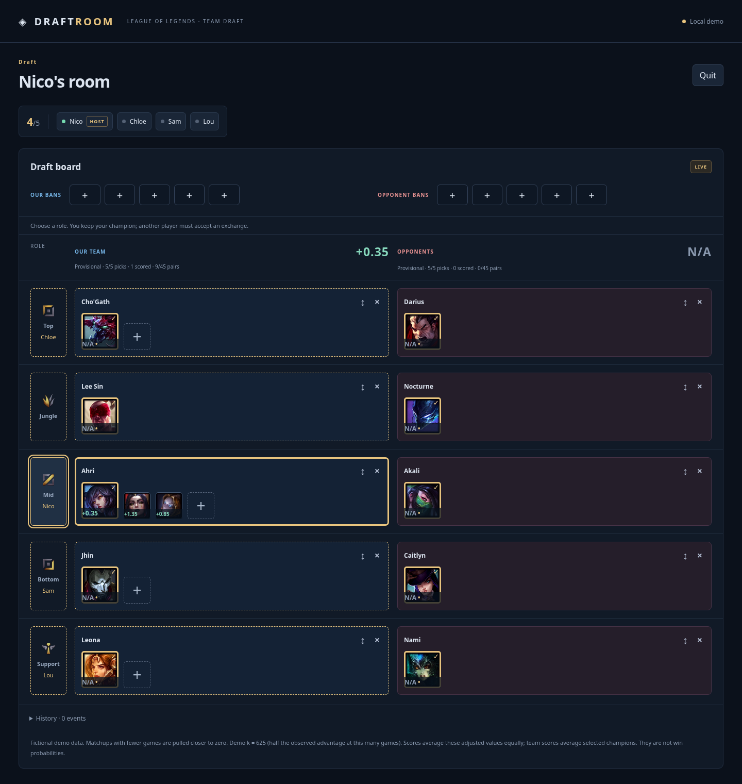

# Panneaux de rôle et filtres initiaux

Demande du 14 novembre 2026, branche `feat/role-panels-picker-defaults`.

- Le panneau de rôle entier est la poignée, avec icône, rôle et pseudo. Il occupe la hauteur de la ligne. Pendant le déplacement, les autres panneaux et toutes les cases alliées deviennent des cibles. Les portraits gardent leur geste distinct de déplacement des champions.
- Le rôle du pool ou de la case est actif dès l'ouverture du sélecteur, avec le tri par popularité. Une réouverture rétablit ces valeurs, même après modification manuelle. Les bans restent tous rôles/popularité ; l'absence de métadonnées conserve le repli tous rôles/alphabétique. Une sélection existante hors rôle reste accessible.
- Aucun changement du consentement, des RPC, du scoring, de la collecte, des statistiques persistées ou des secrets. Aucune migration nécessaire.

Validation locale : **22 parcours Playwright réussis**, build TypeScript/Vite et `git diff --check`. Les parcours existants ont été adaptés aux nouvelles valeurs initiales. Ils vérifient un glisser-déposer depuis le bas du panneau vers le fond d'une case alliée, le consentement, les cibles au clavier et Escape ; les filtres initiaux du lobby, des candidats, des picks ennemis et des bans ; la réouverture après un choix manuel, les sélections hors rôle et le repli sans catalogue. Les contrôles sur mobile restent couverts à 390 et 320 px.

La validation GitHub Actions et la recette hébergée sont documentées après leur résultat, sans transformer les tests locaux de démo en preuve de synchronisation du service réel.
