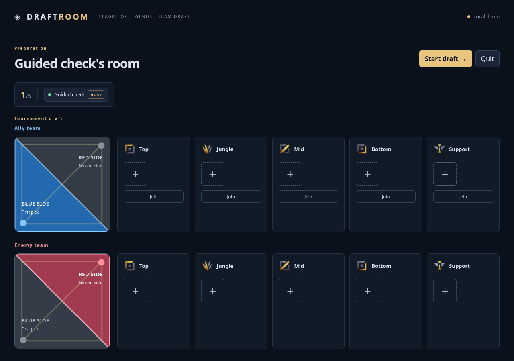
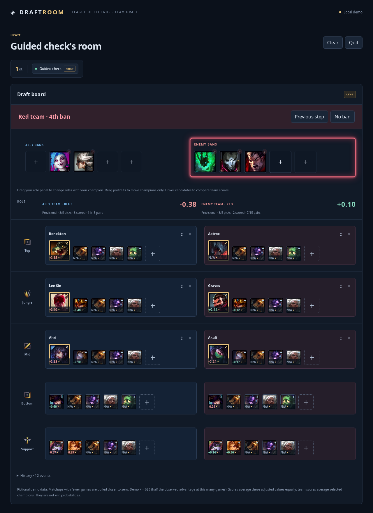

# Lobby compact et sélection immédiate

Demande du 15 novembre 2026, branche `feat/streamlined-lobby-draft`. Ces règles remplacent les confirmations décrites dans [GUIDED_DRAFT.md](GUIDED_DRAFT.md).

## Interface

- Les textes de provenance détaillés du lobby et le titre/texte « Choose your side » sont retirés. La note statistique explicative reste en bas de la draft.
- Une carte **carrée** occupe environ 20 % de la ligne, à gauche des cinq rôles (80 %). Sur petit écran, les rôles défilent dans leur zone sans élargir la page.
- Un camp sélectionné est bleu ou rouge ; l'autre moitié reste grise. Tournament affiche une deuxième carte à gauche des rôles ennemis. Les deux cartes sont complémentaires et pilotent le même choix ; seul l'hôte les modifie, le résultat est synchronisé.
- Les équipes sont nommées **Ally team / Enemy team**, également dans les scores et les contributions.
- Le tour actif a une bordure brillante de la couleur réelle du camp et un agrandissement de 5 %. Les bans ont des portraits carrés. Le bandeau et les bans sont espacés ; les textes de compteur et d'instruction demandés sont supprimés.

Ces captures locales utilisent les données fictives de démonstration.

## Sélections et corrections

Choisir un champion ou un ban termine automatiquement le tour lorsque celui-ci est complet. Un tour à deux picks avance après le **deuxième** choix. L'action d'un invité peut aussi déclencher cette transition. Aucun bouton Confirm ni minuteur n'est ajouté.

Le menu de bans ranked reste ouvert pour sélectionner plusieurs champions, avec la liste des choix retirables et un compteur sur cinq par équipe. Le dixième ban termine automatiquement la phase. L'hôte peut utiliser **Skip remaining bans** pour laisser des cases vides ; en tournament, **No ban** laisse un ban vide et passe au tour suivant. Un ban peut être identique entre les deux équipes en ranked, jamais deux fois dans la même équipe.

**Previous step** permet une correction en revenant au tour précédent ; les réassignations de rôles consenties restent intactes. **Clear**, à côté de Copy invitation / Quit pour l'hôte, remet à zéro les picks, bans, étapes et demandes d'échange en attente. La salle reste dans la draft au début des bans, avec les mêmes membres, rôles, listes de candidats explicites, mode, camp et snapshot statistique. Les compléments populaires sont recalculés.

## Serveur et données

Migration **015**, appliquée après 014 : le serveur vérifie le choix selon le **tour précédent**, avant de l'enregistrer comme étape terminée. Cela empêche d'ajouter un pick ou de modifier un ban d'un tour futur en forgeant simultanément une nouvelle étape et son historique. Les contrôles de consentement, de membres et de version restent actifs.

La RPC `clear_draft` est réservée à l'hôte membre et vérifie la version. Elle revient par les transitions autorisées, efface les choix et publie une seule nouvelle version dans une transaction verrouillée. Aucun drapeau de contournement fourni par le client. Les fonctions internes ne sont pas exposées aux membres.

**Consigne permanente : aucune rétrocompatibilité des salles. À chaque mise à jour, les salles et leurs membres/invitations/demandes temporaires peuvent être supprimés, après vérification. Les statistiques, snapshots, calibrations et catalogues sont conservés.** Ce lot prévoit ce nettoyage dans la transaction de migration, après sauvegarde privée et empreintes des fragments. Aucune réinitialisation des statistiques, rotation de secrets ni nouvelle collecte.

## Validation

111 tests TypeScript/PostgreSQL et 50 tests Python réussis. Le build passe. Les 14 tests de progression utilisent toutes les migrations jusqu'à 015 ; les fixtures historiques des autres suites restent isolées au schéma 013. Les nouveaux contrôles couvrent les transitions atomiques par invité, les deux picks d'un tour, les choix hors tour, Clear sur les deux modes, les conflits de version, les droits et le nettoyage des demandes sans suppression des membres.

Les parcours navigateur vérifient les cartes liées et le gris, le ratio 20/80, les carrés, les bans multiples, les deux séquences complètes, la progression automatique, l'absence des boutons Confirm, Clear et la conservation de la préparation, les bordures de couleur, le dégagement vertical et l'absence de débordement à 390 px. Les résultats de livraison sont ajoutés après vérification du site hébergé.
